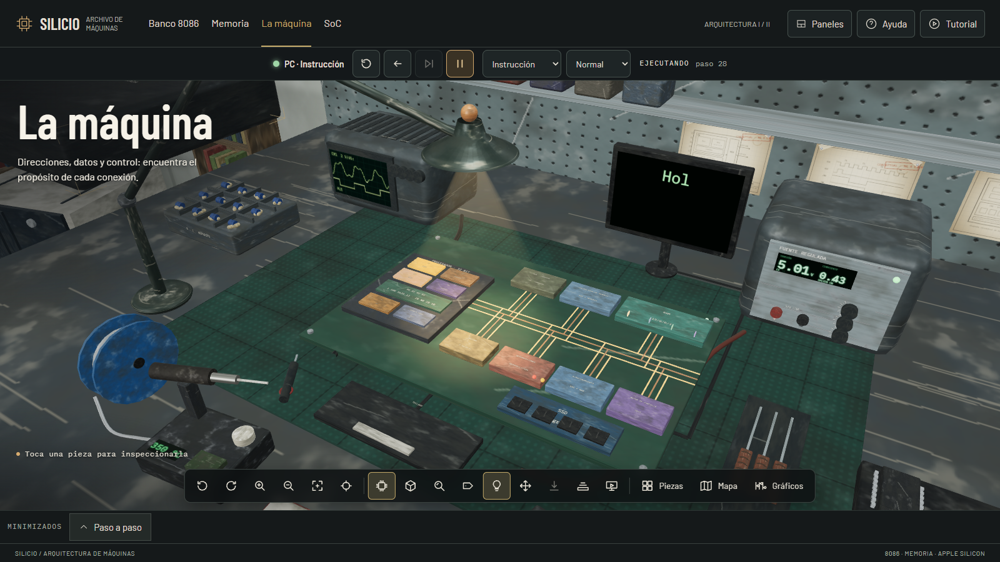

# SILICIO

**Laboratorio interactivo de Arquitectura de Máquinas I y II**



**Videos de las cuatro secciones:**

**Banco 8086 · ejecución paso a paso**

https://github.com/user-attachments/assets/4413077f-8911-4a17-bf01-fe76c7707576

**Memoria · selección de direcciones y bytes**

https://github.com/user-attachments/assets/8a1c15c1-2932-4201-9f30-c0a2c105de45

**La máquina · arranque y ejecución de un programa**

https://github.com/user-attachments/assets/0f7a95cd-3576-4de6-a7f0-7f3a969f4c1c

**SoC · CISC/RISC y memoria compartida**

https://github.com/user-attachments/assets/d5624e9d-208b-4390-8929-cf1227295860

SILICIO es un banco de laboratorio en 3D, dentro del navegador, donde se ve cómo trabaja una computadora por dentro: una instrucción recorre el procesador fase por fase, un dato viaja por los buses hasta la memoria y el texto escrito en el teclado termina en el monitor. Todo avanza paso a paso y se puede retroceder, repetir y comparar.

> **Proyecto de carácter académico.** Se desarrolló como material de estudio para los cursos de Arquitectura de Máquinas I y II. Sus modelos son didácticos y conceptuales: no pretenden reproducir el hardware real ni medir su rendimiento.

## Qué contiene

La aplicación tiene cuatro capítulos que se recorren como las plantas de un edificio, de lo más pequeño a lo más grande:

| Capítulo | Qué se aprende |
| --- | --- |
| **Banco 8086** | Escribir y ensamblar un programa en ensamblador, y seguir cada instrucción por sus siete fases (traer, avanzar, entender, datos, operar, guardar, interrupciones) con registros, ALU y flags a la vista. |
| **Memoria** | Direcciones segmentadas, banco par e impar, jerarquía de memoria y caché, con predicción antes de ejecutar. |
| **La máquina** | Un PC completo: CPU, RAM, ROM, SSD, controlador de teclado, interrupción frente a sondeo y monitor. Cuatro programas: escribir y ver, sumar un archivo, editar y guardar, invertir una imagen. |
| **SoC** | Comparación CISC y RISC con la misma tarea y memoria unificada frente a separada, a partir de un caso de estudio conceptual (Apple M5). |

Herramientas comunes a todos los capítulos:

- **Visor paso a paso**: un solo panel con el ejercicio, las tarjetas de cada paso y los datos. La columna de datos se desplaza sola a lo que cada paso necesita.
- **Escena en 3D** con piezas inspeccionables, vista del chip por capas, rótulos y cámara con transición.
- **Tutoriales guiados** de cada capítulo (botón *Tutorial* de la barra superior), guías por acciones, glosario y atajos en la *Ayuda*.
- **Modo exposición**, que oculta los paneles para presentar y los restaura al terminar.
- **Paneles reubicables** (abajo, a la derecha o flotantes), guardado automático de la sesión y exportación e importación en JSON.
- **Diseño adaptable**: se usa en escritorio y en móvil, con objetivos táctiles de 44 px y respeto de *reduced motion*.

## Tecnologías

Angular 21 (componentes independientes y señales), Three.js, Rapier, GSAP, Lenis y Driver.js. El simulador del 8086 corre en un *web worker*. Las fuentes Barlow, Barlow Condensed e IBM Plex Mono se sirven localmente. No hay peticiones a otros orígenes.

## Empezar

Requiere Node.js y npm.

```sh
npm install
npm start
```

Abre http://localhost:4200.

## Comandos

| Comando | Para qué sirve |
| --- | --- |
| `npm start` | Servidor de desarrollo. |
| `npm run build` | Compila a `dist/silicio/browser`. |
| `npm test -- --watch=false` | Pruebas unitarias (Vitest). |
| `npm run test:e2e` | Pruebas de integración con Playwright (necesitan `npm run build` antes). |
| `npm run preview` | Sirve el paquete compilado en http://127.0.0.1:4300 (puerto configurable con `SILICIO_PORT`). |
| `npm run check:offline` | Comprueba que ninguna fuente carga recursos de otro origen (`-- --dist` revisa también el paquete). |
| `npm run check:geometry` | Comprueba la geometría del banco. |

## Documentación

- [docs/PLAN.md](docs/PLAN.md): plan vigente, con el estado verificado y los pendientes.
- [docs/ARQUITECTURA-DEL-CODIGO.md](docs/ARQUITECTURA-DEL-CODIGO.md): capas, responsables y reglas para ampliar.
- [DESIGN.md](DESIGN.md): dirección visual, paleta, materiales y tipografía.
- [PRODUCT.md](PRODUCT.md): contexto del proyecto.

## Alcance y límites

El simulador ejecuta un subconjunto educativo del 8086, no binarios externos arbitrarios. El RISC del capítulo SoC es didáctico, de estilo ARM, y no reproduce codificaciones reales de AArch64. Arduino no forma parte del proyecto.
