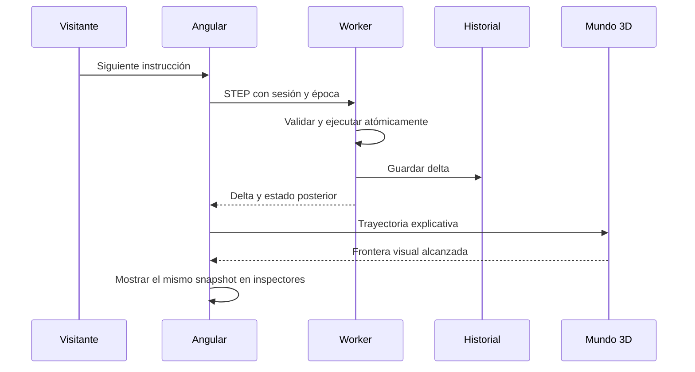

# SILICIO — Especificación técnica y de simulación

> **Revisión 3.0 vigente:** [Escena, instrumentos y móvil](./SILICIO-AMPLIACION-ESCENA-PANEL-Y-MOVIL.md) y [tareas futuras](./SILICIO-IMPLEMENTACION-ESCENA-INSTRUMENTOS-MOVIL.md). Esta revisión modifica solo documentos; no ejecuta implementación.

Versión 2.0 · 12 de octubre de 2026 · Contrato de diseño para implementar; no describe software ya construido.

[Índice del paquete](./SILICIO-INDICE.md) · [Plan maestro](./SILICIO-PLAN-MAESTRO.md) · [Experiencias y misiones](./SILICIO-EXPERIENCIAS-Y-MISIONES.md) · [Verificación](./SILICIO-VERIFICACION-Y-TRAZABILIDAD.md)

## Contenido

- [1. Decisiones cerradas](#1-decisiones-cerradas)
- [2. Límites de cada modelo](#2-límites-de-cada-modelo)
- [3. Contrato Intel 8086 P0](#3-contrato-intel-8086-p0)
- [4. Programas de referencia fijados](#4-programas-de-referencia-fijados)
- [5. Fuentes para el subconjunto](#5-fuentes-para-el-subconjunto)
- [6. Estados, comandos e historial](#6-estados-comandos-e-historial)
- [7. Modelo Apple Silicon](#7-modelo-apple-silicon)
- [8. Banco general y ampliaciones de arquitectura](#8-banco-general-y-ampliaciones-de-arquitectura)
- [9. Aplicación Angular y presentación](#9-aplicación-angular-y-presentación)
- [10. Persistencia e intercambio](#10-persistencia-e-intercambio)
- [11. Catálogo de errores](#11-catálogo-de-errores)
- [12. Entorno de desarrollo y comandos que tendrá el proyecto](#12-entorno-de-desarrollo-y-comandos-que-tendrá-el-proyecto)

## 1. Decisiones cerradas

| Área | Decisión de la primera entrega |
|---|---|
| Aplicación | Angular y TypeScript; componentes standalone, rutas diferidas y señales para estado de interfaz. |
| Integración 3D | Three.js directo, un canvas persistente y un subsistema gráfico con ciclo de vida explícito. |
| Backend gráfico | WebGL2, materiales PBR y addons de la misma versión de Three.js. |
| Animación | GSAP gobierna el ticker visual. Lenis se conecta sin un segundo RAF automático. |
| Procesador | Modelo funcional acotado `intel8086-subset-v1`; instrucciones de 16 bits y codificación real del subconjunto. |
| Modelos adicionales | `machine-basics-v1` para el banco general; `apple-soc-concept-v1` para Apple; `generic16-v1` para ampliaciones comparativas. |
| Ejecución | Worker dedicado; comunicación por mensajes; ninguna instrucción depende de los FPS. |
| Editor | CodeMirror 6 diferido, con gramática y diagnósticos propios del subconjunto. |
| Almacenamiento | Preferencias pequeñas en localStorage; proyectos y sesiones en IndexedDB. |
| Distribución | Aplicación estática, recursos locales y servidor HTTP local para exposición sin red. |
| Pruebas futuras | Vitest para núcleo y contratos; pruebas de navegador con Playwright; inspección visual y perfilado real. |

La versión exacta de los paquetes es un dato de instalación que se registrará con su lockfile al crear el repositorio. La selección de bibliotecas y la distribución de responsabilidades quedan definidas aquí. No se incorporará un segundo motor 3D ni un segundo editor. La revisión 3.0 incorpora Rapier diferido para manipulación acotada del banco, separado del núcleo académico.

## 2. Límites de cada modelo

| Modelo | Estado que controla | Fidelidad | Métricas permitidas |
|---|---|---|---|
| `intel8086-subset-v1` | Registros, flags soportados, memoria, IP e instrucciones | Funcional dentro de la matriz admitida | Instrucciones ejecutadas, lecturas, escrituras y resultados. |
| `machine-basics-v1` | Entrada, registro de trabajo, celda de memoria, salida y señales | Secuencia didáctica declarada | Pasos y valores; no ciclos de un chip comercial. |
| `apple-soc-concept-v1` | Tarea, buffers, versiones y bloques participantes | Organización conceptual documentada | Resultado matemático y etapas del escenario; no GFLOPS ni tiempos de un Mac. |
| `generic16-v1` | CPU didáctica, traza y configuración de memoria | Reglas propias publicadas | Costes en unidades del modelo y aciertos/fallos de caché. |

Un `modelId` acompaña todo programa, estado y evento. Cambiar de familia preserva la sesión anterior y activa otra compatible. El contenido nunca describe la reproducción de una animación como una medición del procesador real.

## 3. Contrato Intel 8086 P0

### 3.1 Estado arquitectónico visible

| Grupo | Elementos | Regla |
|---|---|---|
| Generales | AX, CX, DX, BX, SP, BP, SI, DI | Enteros sin signo de 16 bits; operaciones aritméticas reducidas módulo 65 536. |
| Mitades | AH/AL, CH/CL, DH/DL, BH/BL | Vistas derivadas del mismo registro; no almacenamiento duplicado. |
| Segmentos | CS, DS, SS, ES | Valores de 16 bits establecidos por el cargador o al crear una rama. |
| Flujo | IP | Desplazamiento en bytes, no número de línea del editor. |
| Estado aritmético | CF, PF, AF, ZF, SF, OF | Seis flags observables con actualización por instrucción. |
| Control | TF, IF, DF | Se muestran con su función; permanecen sin efectos ejecutables en P0. |
| Memoria | 1 MiB direccionable por bytes | Memoria del modelo; la escena presenta ventanas de ella. |
| Monitor | Estado, motivo de pausa, sesión, rama y contador | Funciones del laboratorio, diferenciadas del hardware. |

P0 no implementa PUSHF/POPF ni promete el valor binario de los bits reservados de FLAGS. El inspector muestra los flags nombrados; los campos no modelados se identifican así. SP y BP existen aunque las instrucciones de pila se incorporen después. ES se puede inspeccionar aunque los prefijos de segmento y las cadenas estén fuera del subconjunto.

Condiciones predeterminadas de un programa nuevo: CS=1000h, IP=0100h, DS=2000h, SS=3000h, ES=4000h; generales y flags modelados a cero; memoria a cero salvo código y datos del escenario. Estas son condiciones del cargador educativo, no la secuencia de reset de un 8086 físico. Cada misión puede reemplazarlas explícitamente.

### 3.2 Dialecto del editor

1. Una instrucción por línea; comentarios desde `;`; líneas vacías admitidas.
2. Mnemónicos y registros sin distinción de mayúsculas. Etiquetas ASCII con letras, números y `_`, comenzando por letra o `_`; también se normalizan sin distinción de mayúsculas.
3. Literales: decimal `10`, hexadecimal `0x000A` o `000Ah`, binario `0b1010`. Un hexadecimal con sufijo que empiece por letra llevará un cero inicial, como `0FFFFh`.
4. Inmediatos de palabra: −32 768 a 65 535; se almacenan como patrón de 16 bits. Valores fuera del intervalo producen diagnóstico, nunca truncamiento silencioso.
5. La dirección directa entre corchetes es un desplazamiento de 0 a 65 535. El segmento procede de las reglas de direccionamiento, no del texto del literal.
6. Se admiten etiquetas antes de una instrucción o en una línea propia. Los saltos P0 apuntan a etiquetas internas.
7. `JE` es alias de `JZ` y `JNE` de `JNZ`; se conservan en el texto y se normalizan en la representación interna.
8. El tamaño de un operando de memoria es una palabra cuando se usa con un registro de 16 bits. No se admite una forma de tamaño ambiguo.
9. Código y datos iniciales se configuran en campos separados. `ORG`, `DB`, `DW`, macros, includes, segmentos de ensamblador y servicios DOS no pertenecen a este dialecto inicial.
10. Cambiar texto marca el programa como modificado. Ejecutar requiere ensamblar una versión completa válida. Un error conserva la última versión ejecutable y su sesión, con una indicación clara de que no corresponde al texto modificado.

El ensamblador utiliza dos pasadas: primero determina formas, longitudes y etiquetas; después resuelve desplazamientos y emite bytes. Las formas canónicas fijas de la siguiente tabla evitan una dependencia circular por optimización de tamaños.

### 3.3 Matriz exacta de instrucciones y codificación canónica

`r16` pertenece a AX, CX, DX, BX, SP, BP, SI o DI. `m16` es una dirección de memoria admitida. Los valores de opcode se expresan en hexadecimal. `/r` indica un byte ModR/M; `/n` fija su campo `reg` a n. `iw` es inmediato little-endian de 16 bits.

| ID | Forma admitida | Codificación elegida | Efecto |
|---|---|---|---|
| I01 | `MOV r16, imm16` | `B8+registro iw` | Cambia solo el destino. |
| I02 | `MOV r16, r16` | `8B /r`, modo registro | Copia origen a destino. |
| I03 | `MOV r16, m16` | `8B /r` | Lee dos bytes y actualiza registro. |
| I04 | `MOV m16, r16` | `89 /r` | Escribe los dos bytes del registro. |
| I05 | `ADD r16, imm16` | `81 /0 iw` | Suma y actualiza seis flags. |
| I06 | `ADD r16, r16` o `ADD r16, m16` | `03 /r` | Igual semántica; registra la lectura si existe. |
| I07 | `SUB r16, imm16` | `81 /5 iw` | Resta y actualiza seis flags. |
| I08 | `SUB r16, r16` o `SUB r16, m16` | `2B /r` | Igual semántica. |
| I09 | `CMP r16, imm16` | `81 /7 iw` | Calcula flags de resta, conserva ambos operandos. |
| I10 | `CMP r16, r16` o `CMP r16, m16` | `3B /r` | Igual semántica. |
| I11 | `INC r16` | `40+registro` | Suma uno; conserva CF. |
| I12 | `DEC r16` | `48+registro` | Resta uno; conserva CF. |
| I13 | `JMP etiqueta` | `E9 rel16` | Salto relativo cercano; siempre tres bytes. |
| I14 | `JZ etiqueta` / `JE etiqueta` | `74 rel8` | Salta si ZF=1. |
| I15 | `JNZ etiqueta` / `JNE etiqueta` | `75 rel8` | Salta si ZF=0. |
| I16 | `LOOP etiqueta` | `E2 rel8` | CX=(CX−1) mod 65 536; salta si CX≠0; conserva flags. |
| I17 | `NOP` | `90` | Avanza IP. |
| I18 | `HLT` | `F4` | Avanza IP y detiene el monitor en estado `halted`. |

Son doce mnemónicos y dieciocho grupos de formas. No se añaden por implicación formas de 8 bits, MOV a segmentos, operaciones memoria-memoria, inmediato a memoria, destino de memoria para ADD/SUB/CMP, saltos indirectos o lejanos, instrucciones de cadenas ni prefijos. El decoder inicial acepta las codificaciones de esta tabla, no todos los binarios válidos de un 8086.

Otros ensambladores pueden elegir bytes equivalentes más cortos: por ejemplo, formas especiales para AX o inmediato con extensión de signo. Una diferencia de codificación no basta para declarar incorrecto el resultado. La comprobación compara operandos, significado y longitud de cada forma; para comparar bytes se fuerza o identifica la misma variante.

### 3.4 Direccionamiento permitido

| Expresión base | Campo r/m | Segmento predeterminado |
|---|---|---|
| `[BX+SI]` | 000 | DS |
| `[BX+DI]` | 001 | DS |
| `[BP+SI]` | 010 | SS |
| `[BP+DI]` | 011 | SS |
| `[SI]` | 100 | DS |
| `[DI]` | 101 | DS |
| `[BP]` | 110, con desplazamiento | SS |
| `[BX]` | 111 | DS |
| `[disp16]` | 110 con mod=00 | DS |

Cada base admite un desplazamiento constante sumado o restado. Se normaliza el orden de base e índice; no se admiten `[AX]`, `[SP]`, `[BX+BP]`, escalas como `SI*2` ni más de dos registros. El registro BP selecciona SS aunque el valor final del desplazamiento coincida con otra dirección.

Codificación: sin desplazamiento se usa mod=00 excepto `[BP]`, que usa mod=01 y desplazamiento cero. Para desplazamiento firmado entre −128 y 127 se usa mod=01; para los restantes patrones de 16 bits, mod=10. La forma directa usa mod=00, r/m=110 y dos bytes de dirección. Código de registros: AX=0, CX=1, DX=2, BX=3, SP=4, BP=5, SI=6, DI=7.

La dirección efectiva se calcula como la suma de base, índice y desplazamiento reducida a 16 bits. La dirección física se calcula como `((segmento << 4) + offset) & 0xFFFFF`. La calculadora permite ver por separado ambos resultados y la reducción a veinte bits.

Para cerrar P0 sin inventar casos límite, el monitor rechaza una **operación de palabra** cuyo primer byte tenga offset FFFFh o dirección física FFFFFh. La dirección de un byte y los alias de veinte bits sí se pueden explorar. Es una restricción explícita de esta versión del simulador, no una supuesta prohibición del 8086 real. Las palabras desalineadas que no cruzan esos límites sí se soportan, sin atribuirles una penalización temporal no modelada.

### 3.5 Flags y ejecución atómica

Sean `a` y `b` los operandos sin signo de 16 bits y `r` el resultado reducido a 16 bits:

- ZF indica `r=0`; SF coincide con el bit 15 de `r`; PF comprueba paridad par de los ocho bits bajos.
- En ADD, CF indica que la suma sin reducir supera FFFFh. OF detecta operandos de igual signo con resultado de signo opuesto.
- En SUB/CMP, CF indica `a<b`. OF detecta operandos de signo distinto cuyo resultado cambia el signo del primero.
- AF indica acarreo o préstamo entre los bits 3 y 4. Puede comprobarse con el bit 4 de `a XOR b XOR r`.
- INC/DEC calculan los flags aritméticos correspondientes, pero restauran el CF anterior.
- MOV, saltos, LOOP, NOP y HLT conservan los seis flags aritméticos.

Antes de cambiar estado se valida la instrucción completa, sus lecturas, sus escrituras y el destino del salto. Si falla una restricción del monitor, no queda media palabra escrita ni un registro parcialmente modificado. Las escrituras que se solapen con bytes del programa cargado se rechazan: P0 no permite código automodificable.

El cargador admite hasta 16 KiB de código y exige que todo el programa permanezca dentro del mismo segmento de código sin cruzar FFFFh. Los saltos relativos se calculan desde el IP de la instrucción siguiente. JZ/JNZ/LOOP requieren −128…127; JMP utiliza −32 768…32 767. Una etiqueta fuera del intervalo produce diagnóstico. Solo se salta al comienzo de una instrucción ensamblada; esta es otra regla del monitor educativo.

HLT termina la demostración. Las condiciones de despertar por interrupción del procesador físico se explican como contenido posterior, sin fingir que están implementadas.

### 3.6 Representación de BIU, EU y cola

La cola visual tiene seis casillas y muestra bytes procedentes del programa. Se rellena mediante una regla didáctica determinista: mostrar hasta seis bytes desde el punto de consumo, consumir los correspondientes a la instrucción y renovar después. Un salto tomado descarta la presentación secuencial anterior. Se señala como explicación de prelectura, sin reloj de bus exacto ni reproducción de contención BIU/EU.

La trayectoria visual de una instrucción separa: localizar código, leer bytes, decodificar, localizar operandos, leerlos, calcular y confirmar cambios. Algunos pasos se omiten cuando no aplican. La cola y los efectos luminosos se reconstruyen desde la posición elegida; no forman parte de la verdad arquitectónica que determina resultados.

## 4. Programas de referencia fijados

Los siguientes programas son fixtures de diseño. Sus resultados esperados están definidos; la futura implementación deberá ejecutarlos y contrastarlos. Los datos se cargan desde el escenario, no mediante directivas de ensamblador.

### F01 — Suma de la práctica

Condiciones: AX=7, DS=2000h, memoria física 2000Ah=05h y 2000Bh=00h; CS:IP=1000h:0100h.

```asm
ADD AX, [10]
HLT
```

Bytes canónicos: `03 06 0A 00 F4`. Tras ADD: AX=000Ch, IP=0104h, lectura de la palabra en 2000Ah, cero escrituras de datos. CF=0, PF=1, AF=0, ZF=0, SF=0, OF=0. Tras HLT: IP=0105h y estado detenido. Memoria conserva 05h,00h.

### F02 — Dos interpretaciones del resultado

```asm
MOV AX, 0FFFFh
ADD AX, 1
HLT
```

Bytes: `B8 FF FF 81 C0 01 00 F4`. Resultado AX=0000h; CF=1, PF=1, AF=1, ZF=1, SF=0, OF=0. Variante cambiando el inmediato inicial a `07FFFh`: AX=8000h; CF=0, PF=1, AF=1, ZF=0, SF=1, OF=1. La misión se detiene tras ADD para explicar los flags de esa operación.

### F03 — Sumar cuatro palabras

Datos en DS:0000h: palabras 1,2,3,4; ocho bytes `01 00 02 00 03 00 04 00`.

```asm
MOV AX, 0
MOV CX, 4
MOV SI, 0
bucle:
ADD AX, [SI]
ADD SI, 2
LOOP bucle
HLT
```

| IP | Bytes | Instrucción |
|---|---|---|
| 0100h | B8 00 00 | MOV AX,0 |
| 0103h | B9 04 00 | MOV CX,4 |
| 0106h | BE 00 00 | MOV SI,0 |
| 0109h | 03 04 | ADD AX, [SI] |
| 010Bh | 81 C6 02 00 | ADD SI,2 |
| 010Fh | E2 F8 | LOOP bucle |
| 0111h | F4 | HLT |

Resultado final: AX=10, CX=0, SI=8, IP=0112h; 16 instrucciones ejecutadas contando HLT; cuatro lecturas de palabra y ninguna escritura de datos. Los flags finales pertenecen al último `ADD SI,2`, porque LOOP conserva flags. CX=0 no implica ZF=1.

### F04 — Error de segmento

Usa F01 con una diferencia: la rama A empieza con DS=2100h y la palabra en 2100Ah vale 9. Obtiene AX=16. La rama B restaura el estado **anterior a ADD**, cambia DS a 2000h y obtiene AX=12. El escenario guarda ambas zonas de memoria y explica por qué el mismo desplazamiento leyó lugares distintos. No se corrige el error cambiando el resultado final a mano.

### F05 — Comparación y salto

```asm
MOV AX, 7
CMP AX, 7
JZ iguales
MOV BX, 99
JMP fin
iguales:
MOV BX, 1
fin:
HLT
```

Debe terminar con AX=7 y BX=1. La variante `CMP AX,8` termina con BX=99. CMP conserva AX. Se comprobará que los destinos corresponden a límites de instrucciones y que el camino no elegido no produce cambios arquitectónicos.

### F06 — Escritura y representación

```asm
MOV AX, 01234h
MOV [32], AX
MOV BX, [32]
HLT
```

Con DS=2000h: direcciones 20020h y 20021h reciben 34h y 12h; BX termina en 1234h. La visualización resalta esos dos bytes, no la instrucción ni una región completa de memoria.

## 5. Fuentes para el subconjunto

La matriz y la codificación se apoyan en [Programming the 8086/8088](<D:/Books/Arquitectura de maquinas/Programming_the_8086_8088.pdf>), de James W. Coffron: capítulos 2–4; páginas impresas 58–62 para codificación y ModR/M, 73 para ADD, 128 para LOOP, 131–132 para MOV y 166 para SUB. En esta copia corresponden a páginas PDF 72–76, 87, 142, 145–146 y 180. Se consultaron esos capítulos de forma selectiva.

El [manual original de Intel](https://www.inf.pucrs.br/~calazans/undergrad/orgcomp_EC/mat_microproc/intel-8086_family_Users_Manual.pdf) sirve para contrastar la arquitectura. Como herramienta independiente de ensamblado se elige [NASM con BITS 16 y CPU 8086](https://www.nasm.us/doc/nasm08.html); su [inventario de instrucciones](https://www.nasm.us/doc/nasmaf.html) permite revisar la familia soportada. NASM no reemplaza un emulador para comprobar estados.

La futura verificación funcional usará una segunda referencia de ejecución disponible, o trazas manuales revisadas por otra persona/agente con los manuales. El informe registrará cuál se utilizó: no se afirmará una comparación contra un emulador que no haya sido ejecutado.

## 6. Estados, comandos e historial

### 6.1 Máquina de estados del monitor

| Estado | Acciones habilitadas | Transición relevante |
|---|---|---|
| Vacío | Elegir misión, importar, editar | Ensamblar/cargar lleva a Preparando. |
| Preparando | Cancelar | Validación correcta lleva a Preparado; error conserva la sesión anterior. |
| Preparado | Paso, ejecutar, editar condiciones, exportar | Paso lleva a Pausado; ejecutar a Ejecutando. |
| Ejecutando | Pausar, cambiar velocidad visual | Pausa, límite o salida de sala llevan a Pausado; HLT a Detenido. |
| Pausado | Paso, ejecutar, retroceder, buscar estado, crear rama, exportar | La ejecución continúa desde un estado consistente. |
| Detenido | Retroceder, restablecer, exportar | Reanudar requiere un estado anterior a HLT o una nueva carga. |
| Error de ejecución | Inspeccionar, retroceder, restablecer, exportar | La última instrucción inválida no modifica el estado. |

Un error de sintaxis pertenece al editor y no convierte una sesión válida previa en una sesión rota. Las vistas distinguen «texto editado» y «programa cargado» mediante su revisión.

### 6.2 Protocolo del worker

Todo mensaje lleva `protocolVersion`, `sessionId`, `epoch`, `commandId` y `sequence`. La secuencia es monótona dentro de una época. Cargar otro programa o invalidar una sesión incrementa la época; una respuesta antigua se descarta. `branchId` identifica el historial al que pertenece una operación.

| Comando | Entrada | Respuesta | Condición |
|---|---|---|---|
| `ASSEMBLE` | Fuente y origen | Bytes, diagnósticos, mapa de instrucciones | No cambia la sesión ejecutada. |
| `LOAD` | Programa válido y condiciones | Snapshot inicial y descriptor | Validación atómica antes de sustituir sesión. |
| `STEP` | Rama y posición | Un delta y snapshot posterior | Solo desde estado no ejecutando y no detenido. |
| `RUN` | Presupuesto de instrucciones | Lotes de deltas y estado | Nunca bloquea indefinidamente el procesamiento de mensajes. |
| `PAUSE` | Identidad activa | Confirmación y posición final | Se detiene en frontera de instrucción. |
| `SEEK` | Índice del historial | Estado restaurado y ventana solicitada | Pausa primero; no reproduce efectos externos. |
| `FORK` | Posición y cambios iniciales | Nueva rama y snapshot base | Valida registros y bytes editados. |
| `RESET` | Rama o misión | Snapshot inicial | Conserva una recuperación de la sesión anterior. |
| `READ_MEMORY` | Dirección y longitud | Hasta 256 bytes y revisión | No envía 1 MiB en cada interacción. |
| `EXPORT` | Sesión y opciones | Proyecto o traza portable | Respeta límites de tamaño. |
| `DISPOSE` | Identidad | Confirmación y liberación | Cancela lotes y elimina recursos de la sesión indicada. |

Parámetros iniciales: lotes de hasta 500 instrucciones o aproximadamente 8 ms de trabajo, el límite que llegue antes; publicación de estado de reproducción rápida hasta 10 veces por segundo; respuesta inmediata al paso o pausa. La velocidad de una animación se controla en la presentación. Una ejecución rápida no obliga a dibujar una transición por cada instrucción.

Cada lote cede el control al bucle de eventos del worker antes del siguiente. El botón Pausar no puede depender de que termine el programa. Un watchdog de interfaz detecta ausencia de respuesta, permite reiniciar el worker y conserva el último proyecto guardado; no altera registros para fingir continuidad.

### 6.3 Contratos de datos

| Tipo | Campos obligatorios | Invariante |
|---|---|---|
| `ModelDescriptor` | ID, versión, familia, capacidades, límites, fuentes | La familia determina qué programas son compatibles. |
| `ProgramBundle` | Fuente, revisión, bytes, CS/IP iniciales, mapa y datos | El mapa corresponde exactamente a los bytes cargados. |
| `MachineSnapshot` | Modelo, sesión, rama, índice, registros, flags, memoria versionada, estado del monitor | Representa una frontera completa de instrucción. |
| `ExecutionDelta` | IP anterior/posterior, instrucción, bytes, lecturas, escrituras, cambios, salto, motivo de parada | Contiene lo necesario para aplicar y revertir cambios. |
| `MemoryAccess` | Tipo, dirección física, segmento/offset si aplica, tamaño, valor y orden | Se diferencia fetch de lectura/escritura de datos. |
| `RegisterChange` | Nombre, valor anterior y posterior | Valores dentro del ancho del modelo. |
| `FlagChange` | Nombre, anterior, posterior y estado de definición | Un flag no definido no se muestra como resultado garantizado. |
| `SceneBinding` | ID semántico, nombre de nodo, tipo de selección y foco | La geometría no determina el cálculo. |
| `ScenarioDefinition` | ID, modelo, condiciones, pasos, verificadores, pistas y fuentes | Puede reiniciarse con el mismo resultado. |
| `SourceRecord` | ID, título, autor, enlace, sección, fecha y afirmaciones | Una cifra comercial identifica variante y configuración. |

Las lecturas de instrucción se registran en una categoría distinta. Cuando un ejercicio informa «cuatro lecturas de palabra» se refiere a operandos de datos, no a bytes de código ni a accesos visuales de la cola ilustrativa.

### 6.4 Historia reversible

- Guardar delta por instrucción y checkpoint cada 256 instrucciones; usar páginas de memoria de 4 KiB con copia al escribir y referencias inmutables.
- Límite inicial: 10 000 instrucciones por captura y 64 MiB para el conjunto de trazas activas. Alcanzarlo pausa antes de agregar un elemento que exceda el límite.
- Una captura corresponde al historial de una rama: el límite de instrucciones se aplica por rama y el de 64 MiB al conjunto, contabilizando una sola vez las páginas compartidas.
- P0 conserva hasta dos ramas comparables A/B. Crear otra ofrece guardar/exportar y sustituir una rama elegida; no elimina la original silenciosamente.
- Buscar una posición restaura el checkpoint previo y aplica deltas hasta el índice solicitado. Regresar comprueba valores, no solo posición de la cámara.
- Editar un estado histórico crea una rama. Reproducir desde una posición anterior con cambios sigue la misma regla.
- Una nueva captura puede partir del estado actual como nuevo origen; se declara ese origen y se ofrece conservar la anterior como exportación.
- Audio, bloom y partículas son efectos de presentación. Restaurar no duplica sonidos ni incrementa los contadores de misión por visitar de nuevo una instantánea.

Pausa y retroceso actúan en fronteras de instrucción. Si hay una animación intermedia, Pausar la lleva al límite consistente de esa instrucción. Durante la transición, los valores intermedios se rotulan como operandos o resultado calculado; los registros se actualizan al confirmar. El cabezal de ejecución del worker y el cursor que el visitante inspecciona son posiciones distintas y no se sobrescriben entre sí.

## 7. Modelo Apple Silicon

### 7.1 Contenido y geometría

El escenario principal representa M5 con bloques funcionales: CPU, GPU, Neural Engine, memoria unificada y motores especializados. Los subcomponentes se agregan según fuentes públicas. Un bloque que representa una clase de unidad no equivale automáticamente a un núcleo físico ni a un plano de silicio a escala.

La ficha de variantes separa modelo, configuración, nombre comercial de núcleos, CPU, GPU, Neural Engine, memoria y ancho de banda. No se rellena un dato ausente a partir de una interpolación. La fuente de partida es el [anuncio oficial de M5](https://www.apple.com/newsroom/2025/10/apple-unleashes-m5-the-next-big-leap-in-ai-performance-for-apple-silicon/), complementado por las fuentes por variante del plan maestro.

### 7.2 Tres tareas reproducibles

| Escenario | Entrada de diseño | Operación | Resultado esperado | Papel mostrado |
|---|---|---|---|---|
| A01, secuencia | Vector [1,2,3,4] | Acumulación de cuatro valores | 10 | CPU como unidad apropiada para la explicación secuencial. |
| A02, transformación paralela | Intensidades [0,64,128,255], ganancia 1,25 | Por elemento: redondear y limitar a 0…255 | [0,80,160,255] | GPU y trabajo independiente sobre elementos. |
| A03, operación neural ilustrativa | x=[1,2], W=[[2,1], [-1,0]], sesgo=[0,0] | y=ReLU(Wx+sesgo) | [4,0] | Unidad especializada y multiplicación/acumulación conceptual. |

La asociación de una tarea con una unidad es pedagógica: una CPU también puede multiplicar matrices y una GPU también puede procesar IA. La interfaz separa el Neural Engine de los aceleradores neurales integrados en la GPU cuando estos aparecen en la variante documentada. No se reproduce un planificador de macOS ni se supone que Core ML enviaría exactamente esa operación a ese bloque.

A02 permite ganancia de 0 a 2 en pasos de 0,25. A03 permite cambiar los dos elementos de x entre −4 y 4, con pesos visibles y fijos. Los resultados se calculan con funciones deterministas del escenario. No se requieren modelos de IA externos, cargas de archivos ni acceso a servicios de pago.

### 7.3 Buffers y memoria compartida

Un buffer del modelo tiene ID, longitud, valores, versión y etapa que lo produjo. La secuencia P0 es: CPU prepara entrada B0; la unidad seleccionada lee B0 y produce B1; una señal de finalización del escenario permite a CPU consultar B1. La memoria se mantiene como un conjunto accesible por los bloques representados.

La animación conserva las identidades B0/B1 a lo largo del recorrido. Elegir otra unidad no genera una copia visual automática a otra RAM. Se muestran las sincronizaciones necesarias entre etapas del escenario. Esta regla ilustra un caso compatible con memoria compartida; no afirma que cualquier aplicación real elimine todas las copias, conversiones o esperas.

Controles: elegir tarea, cambiar entrada admitida, predecir resultado, avanzar etapa, ejecutar secuencia, inspeccionar buffer y restablecer. El contador dice «etapa 2 de 3», nunca «2 ciclos de M5». La comparación temporal con 8086 queda fuera del escenario.

## 8. Banco general y ampliaciones de arquitectura

### 8.1 `machine-basics-v1`

El banco general usa una secuencia de seis pasos: capturar entrada A; capturar B; llevar A al registro de trabajo; sumar B; guardar resultado en una celda; presentar salida. A y B pueden elegirse entre 0 y 15, de modo que el resultado cabe sin introducir overflow en la primera lección. La siguiente actividad amplía los valores para explicar el ancho de palabra.

Cada transferencia contiene origen, destino, dirección si corresponde, valor y señal de control. El visitante puede ocultar/mostrar rutas de dirección, datos y control. No puede conectar arbitrariamente una salida a dos conductores incompatibles y obtener una simulación eléctrica ficticia.

La comparación Von Neumann/Harvard representa organización de almacenamiento y caminos de acceso. Es un esquema lógico; no se presenta el modelo simplificado como descripción completa de todas las cachés de una CPU moderna.

### 8.2 `generic16-v1`, P1

CPU didáctica con cuatro registros R0–R3 de 16 bits, memoria de datos de 256 palabras, PC como índice de instrucción y flags Z/N para las actividades. El programa es una lista de instrucciones simbólicas; su visualización no finge una codificación binaria del 8086.

ISA didáctica: `MOVI Rn, valor`, `LOAD Rn, dirección`, `STORE dirección, Rn`, `ADD Rn, Rm`, `SUB Rn, Rm`, `CMP Rn, Rm`, `JNZ índice` y `HALT`. Operaciones reducidas a 16 bits; CMP actualiza Z/N sin escribir operandos; JNZ consulta Z. Un acceso fuera de 0…255 produce error del modelo.

Dos organizaciones ejecutan la misma lista y conservan su resultado. La diferencia inicial está en la memoria y su caché; costes siempre expresados en unidades didácticas. El modelo de puertos y de fetch se puede ampliar después con su versión y reglas temporales propias.

### 8.3 Caché comparable, P1

Experimento inicial: caché de mapeo directo, bloques de 16 bytes, cuatro u ocho líneas, estado inicial vacío y una traza de lecturas. La dirección es física en bytes. El bloque es `floor(dirección/16)`; índice `bloque mod líneas`; etiqueta `floor(bloque/líneas)`. Al fallar se reemplaza la línea del índice.

Costes elegidos para el ejercicio: hit=1 unidad; miss=11 unidades, incluyendo consulta y carga. No son latencias de un producto. La secuencia 0000h,0002h,0040h,0000h produce M, H, M, M con cuatro líneas y M, H, M, H con ocho: 34 frente a 24 unidades. La lectura devuelve los mismos datos en ambos casos.

La traza puede proceder de una ejecución 8086, pero se analiza en este experimento separado: no se añade una caché interna ficticia al 8086. Si un acceso abarca dos bloques, se divide en dos consultas y la interfaz distingue accesos de CPU de consultas de caché. La versión inicial de comparación usa lecturas; políticas de escritura, asociatividad y reemplazo adicional corresponden a una ampliación versionada.

### 8.4 Especulación y ejecución fuera de orden, P2

Se creará `generic-ooo-v2` con ISA y estado propios, no modificando silenciosamente sesiones v1. Configuración educativa inicial: emisión de hasta dos operaciones por paso, confirmación de una por paso, buffer de reordenamiento de cuatro entradas, dos unidades aritméticas y predictor bimodal de dieciséis contadores de dos bits, inicializados en 01 (débilmente no tomado).

La ISA simbólica extiende la del modelo general con multiplicación y salto incondicional; conserva resultados de 16 bits. Costes educativos iniciales: ALU simple=1 paso, multiplicación=3, lectura con acierto=2 y con fallo=10; una escritura confirmada requiere un paso de acceso en este modelo. Un salto se resuelve al disponer de sus operandos y usar la unidad aritmética. Estos parámetros se muestran en la configuración, son reproducibles y no describen un procesador comercial.

Resultado especulativo, resultado confirmado y estado arquitectónico tienen representaciones distintas. Una predicción incorrecta cancela las operaciones posteriores del camino equivocado y restaura el punto de recuperación. Los stores se hacen visibles al confirmar; un load espera si una escritura anterior tiene dirección aún desconocida. Renombrado y seguimiento de dependencias impiden WAW/WAR, y RAW espera el operando correcto.

La ampliación exige escenarios de dependencia, salto acertado/fallido, excepción preparada y orden de confirmación. Antes de aceptarla, una ejecución secuencial equivalente debe producir el mismo estado final. Las unidades del modelo no se convierten en afirmaciones sobre ciclos internos de Apple.

## 9. Aplicación Angular y presentación

### 9.1 Rutas

| Ruta lógica | Experiencia | Persistencia |
|---|---|---|
| `/` | Entrada y atrio | Preferencias y último recorrido. |
| `/laboratorio/8086` | Banco 8086 | Sesión Intel activa. |
| `/laboratorio/memoria` | Galería | Misma sesión Intel y dirección seleccionada. |
| `/laboratorio/tiempo` | Cronoscopio | Mismas ramas e índice de inspección. |
| `/laboratorio/apple` | Observatorio | Sesión Apple independiente. |
| `/laboratorio/buses` | Banco general | Escenario propio, reutiliza entorno. |
| `/laboratorio/fundicion` | Ampliación P1 | Solo aparece como acceso funcional al estar disponible. |
| `/presentacion` | Recorrido del docente | Presets y acceso directo a los seis momentos del guion. |
| `/fuentes` | Bibliografía y límites | Contenido local consultable. |

La primera distribución usa navegación con hash para que una recarga funcione desde un servidor estático sencillo. El canvas pertenece al shell persistente; cambiar ruta activa/desactiva la escena y los paneles, sin crear otro renderer. Parámetros como misión y componente se validan; una URL no ejecuta código ni selecciona un modelo desconocido.

### 9.2 Responsabilidades del software

| Módulo | API conceptual | No debe hacer |
|---|---|---|
| `SessionFacade` | load, step, run, pause, seek, fork | Calcular instrucciones o manipular mallas. |
| `WorkerClient` | enviar, cancelar, validar época/secuencia | Mostrar notificaciones directamente. |
| `Intel8086Core` | reset, decode, execute | Importar Angular, Three.js o GSAP. |
| `HistoryStore` | append, checkpoint, restore, branch | Animar el retroceso. |
| `WorldEngine` | initialize, render, resize, dispose | Ser fuente de verdad de memoria/registros. |
| `SceneController` | enter, focus, inspect, exit | Modificar directamente el núcleo. |
| `InputRouter` | asignar gesto a contexto | Dejar dos consumidores activos para el mismo gesto. |
| `AssetRegistry` | adquirir/liberar recurso y estado de carga | Eliminar una textura aún referenciada. |
| `ScenarioRunner` | iniciar, evaluar paso, pista, reiniciar | Calificar respuestas abiertas con reglas inventadas. |
| `ProjectRepository` | guardar, listar, validar, importar/exportar | Cargar contenido ejecutable de un JSON. |

El núcleo puro se prueba sin DOM. Angular publica estados con señales y no recibe transformaciones por frame. El inspector se actualiza al cambiar el cursor de la sesión; Three.js consume el mismo estado seleccionado.

### 9.3 Secuencia de una acción



Un salto de animación lleva inmediatamente al estado posterior correcto. Si la escena no está visible, el inspector puede mostrarlo sin reproducir la trayectoria. El resultado nunca depende de recibir el callback de una animación.

## 10. Persistencia e intercambio

| Contenido | Almacén | Límite inicial | Política |
|---|---|---|---|
| Calidad, volumen, movimiento y notación | localStorage | Hasta 16 KiB | Escritura solo al cambiar preferencia. |
| Proyectos | IndexedDB | Diez proyectos locales | Guardar fuente, datos iniciales y notas; edición manual y autoguardado con debounce de 1 s. |
| Traza activa | Worker/memoria e IndexedDB al guardar | 10 000 instrucciones y presupuesto global definido | Guardado explícito; no persistir cada frame. |
| Progreso | IndexedDB | Por misión y versión | Guarda actividad y evidencia breve, sin datos de compañeros. |
| Archivos exportados | JSON descargable | Hasta 5 MiB por proyecto P0 | No empaquetar texturas ni los libros del curso. |

Formato de proyecto: `schemaVersion`, `modelId`, `modelVersion`, `title`, `source`, `initialRegisters`, `initialMemoryRanges`, `scenarioId`, `notes` y `createdAt`. La traza exportada es una opción separada. No se toma un timestamp o nombre de archivo como prueba de identidad.

La importación valida estructura, tipos, tamaños, modelo y direcciones antes de sustituir el proyecto abierto. Se limita a diez rangos iniciales y 64 KiB de datos por proyecto importado P0; memoria no especificada queda en cero. Los formatos desconocidos dan un diagnóstico y conservan el trabajo actual. Si IndexedDB no está disponible, se habilita trabajo temporal y exportación manual.

La aplicación no requiere autenticación, analítica remota, chat de IA, pagos ni backend para P0. La ayuda de agentes se aplica al desarrollo; no obliga a enviar programas del visitante a una API.

## 11. Catálogo de errores

| Código | Situación | Mensaje orientativo y recuperación |
|---|---|---|
| `ASM_UNKNOWN` | Mnemónico no admitido | «Esta versión no admite X. Consulta las instrucciones disponibles». Mantener texto. |
| `ASM_OPERAND` | Forma o registro incorrecto | Señalar operando y ejemplo válido, sin reemplazarlo automáticamente. |
| `ASM_RANGE` | Inmediato o desplazamiento fuera de rango | Mostrar intervalo y valor recibido. |
| `ASM_LABEL` | Etiqueta duplicada o ausente | Marcar nombre y líneas relacionadas. |
| `SIM_WORD_BOUNDARY` | Palabra cruza límite excluido | Explicar la restricción del simulador y permitir cambiar datos/dirección. |
| `SIM_CODE_WRITE` | Escritura sobre programa | Conservar estado previo y mostrar direcciones afectadas. |
| `SIM_EXEC_RANGE` | Ejecución fuera del programa o destino inválido | Pausar en el último estado correcto. |
| `SIM_BUDGET` | Captura alcanza límite | Pausar y ofrecer exportar o iniciar captura nueva. |
| `WORKER_TIMEOUT` | Sin respuesta | Reintentar/reiniciar sin borrar el proyecto guardado. |
| `ASSET_LOAD` | Recurso no disponible | Reintentar o regresar a una sala cargada; no presentar un componente invisible como cargado. |
| `WEBGL_UNAVAILABLE` | No se crea contexto | Mostrar explicación y acceso a contenido textual; no afirmar que el modo 3D funciona. |
| `WEBGL_CONTEXT_LOST` | Contexto perdido | Pausar, conservar sesión e intentar restaurar recursos. |
| `STORE_QUOTA` | Almacenamiento lleno | Exportar y gestionar proyectos, conservando el estado en memoria. |
| `IMPORT_SCHEMA` | Archivo incompatible | Explicar versión/modelo esperado, sin ejecutar contenido. |

## 12. Entorno de desarrollo y comandos que tendrá el proyecto

Se utilizará npm con lockfile y una versión compatible de Node registrada en el repositorio. Se separarán dependencias de ejecución de herramientas de prueba y procesamiento de recursos. Los scripts de abajo son requisitos del repositorio futuro; no son comandos ya existentes en este paquete de planificación.

| Script previsto | Responsabilidad |
|---|---|
| `npm run start` | Servir el entorno de desarrollo. |
| `npm run build` | Generar la aplicación estática de producción. |
| `npm run test:core` | Ejecutar vectores de CPU, ensamblador, historia y escenarios. |
| `npm run test:app` | Comprobar integración de componentes y worker. |
| `npm run test:e2e` | Recorrer misiones, navegación, guardado y errores relevantes. |
| `npm run check:content` | Validar IDs, fuentes, modelos y vínculos de las misiones. |
| `npm run check:assets` | Revisar manifiestos, nombres, tamaños, procedencia y recursos faltantes. |
| `npm run preview:local` | Servir la compilación con todos sus recursos locales. |

La documentación de [pruebas de Angular](https://angular.dev/guide/testing) respalda el uso de su configuración de Vitest. Los tests de núcleo comprobarán semántica y límites; los de navegador se concentrarán en recorridos y coordinación, evitando reproducir cada operación aritmética a través de la interfaz.

No quedan por elegir tecnologías alternativas para comenzar. El primer hito verifica herramientas, versiones compatibles y hardware; registra esos datos y ejecuta la primera integración especificada.


## 13. Contratos de la ampliación 3.0

La [especificación vigente](./SILICIO-AMPLIACION-ESCENA-PANEL-Y-MOVIL.md) y [tareas R00–R12](./SILICIO-IMPLEMENTACION-ESCENA-INSTRUMENTOS-MOVIL.md) incorporan fachada, registro de interacciones, cámara por región libre, rack de instrumentos y física del banco.

El motor del CPU sigue aislado. Los diagramas consumen datos resueltos del evento; no reimplementan aritmética ni flags. La autoridad de transform diferencia fijo, dinámico ycinemático. El ciclo físico no gobierna instrucciones.

RAM:
- Placa clásica según ficha2164A; la representación de bancos no cambia silenciosamente la memoria lógica existente.
- Módulo moderno en escenario propio; no se conecta al8086 ni se atribuye aM5.
- Datos/partes se actualizan sin regenerar el ensamblaje por cada byte o selección.

R00 debe reconciliar diferencias entre contrato histórico y software antes de modificar condiciones iniciales, límites de palabras, trazas/importación o rutas. Este documento no acredita que el plan2.0 esté íntegramente implementado.
