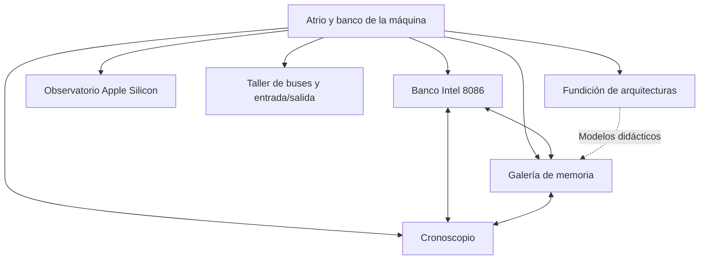
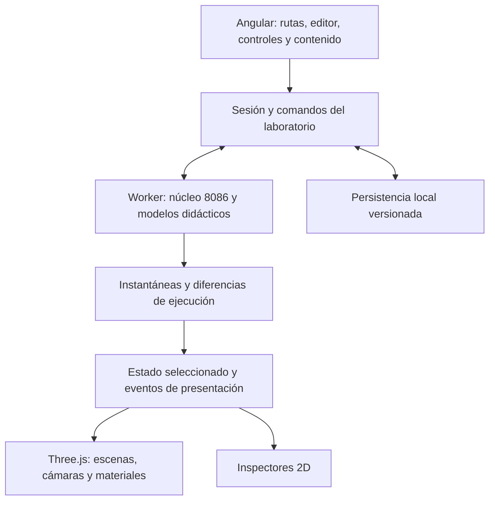

# SILICIO

> **Revisión 3.0 vigente:** [Escena, instrumentos y móvil](./SILICIO-AMPLIACION-ESCENA-PANEL-Y-MOVIL.md) y [tareas futuras](./SILICIO-IMPLEMENTACION-ESCENA-INSTRUMENTOS-MOVIL.md). Esta revisión modifica solo documentos; no ejecuta implementación.

## Plan maestro de una experiencia inmersiva de arquitectura de computadores

Versión 2.0 · 12 de octubre de 2026 · Estado: planificación detallada completada; implementación y validación del producto pendientes.

**SILICIO será un laboratorio tridimensional habitable dedicado al Intel 8086, Apple Silicon y los principios de funcionamiento de una computadora.** El visitante podrá abrir componentes, seguir una instrucción, inspeccionar memoria y reconstruir una ejecución. La apariencia será la de un laboratorio operativo que acumula años de uso: materiales reconocibles, desgaste localizado e instrumentos manipulables.

El proyecto tendrá una identidad, un sistema de navegación y herramientas de inspección comunes. Cada familia de procesadores conservará sus propias reglas y su nivel de fidelidad. La primera entrega se organiza para siete días de trabajo intensivo de una persona con apoyo de agentes de IA. El documento describe también la visión posterior; las prioridades distinguen lo que se pretende entregar esa semana de las ampliaciones.

Este documento presenta la visión y sus decisiones. Los anexos especifican las acciones, contratos y criterios necesarios para implementarla. El [índice general](./SILICIO-INDICE.md) describe el orden de lectura y el cierre de la revisión.

Documentos complementarios:

- [Plan de ejecución y coordinación de agentes](./SILICIO-PLAN-DE-EJECUCION.md).
- [Propuesta para presentar en la asignatura](./SILICIO-PROPUESTA-ACADEMICA.md).
- [Experiencias y misiones detalladas](./SILICIO-EXPERIENCIAS-Y-MISIONES.md).
- [Especificación técnica y de simulación](./SILICIO-ESPECIFICACION-TECNICA.md).
- [Dirección de arte, producción 3D e interacción](./SILICIO-DIRECCION-3D-Y-UX.md).
- [Requisitos, verificación y trazabilidad](./SILICIO-VERIFICACION-Y-TRAZABILIDAD.md).

En la versión 2.0 se cerraron la sintaxis y formas del subconjunto 8086, los programas de referencia, los pasos y resultados de las misiones, los escenarios Apple, los contratos de sesión y la producción de recursos. El plan de ejecución conserva 28 paquetes P0, ahora desglosados, y añade ocho ampliaciones con dependencias. La matriz contiene 38 requisitos y 70 casos de comprobación futura.

## Contenido

- [1. Decisiones fijadas por el encargo](#1-decisiones-fijadas-por-el-encargo)
- [2. Objetivo y resultados de aprendizaje](#2-objetivo-y-resultados-de-aprendizaje)
- [3. Concepto del mundo](#3-concepto-del-mundo)
- [4. Prioridades y límites de fidelidad](#4-prioridades-y-límites-de-fidelidad)
- [5. Catálogo completo de experiencias](#5-catálogo-completo-de-experiencias)
- [6. Misiones y recorrido de aprendizaje](#6-misiones-y-recorrido-de-aprendizaje)
- [7. Dirección de arte y realismo](#7-dirección-de-arte-y-realismo)
- [8. Interacción y relación entre 3D y 2D](#8-interacción-y-relación-entre-3d-y-2d)
- [9. Especificación inicial del núcleo 8086](#9-especificación-inicial-del-núcleo-8086)
- [10. Evaluación del stack y decisiones técnicas](#10-evaluación-del-stack-y-decisiones-técnicas)
- [11. Arquitectura del software](#11-arquitectura-del-software)
- [12. Pipeline gráfico](#12-pipeline-gráfico)
- [13. Presupuestos de rendimiento](#13-presupuestos-de-rendimiento)
- [14. Contenido y fuentes](#14-contenido-y-fuentes)
- [15. Persistencia, distribución y funcionamiento local](#15-persistencia-distribución-y-funcionamiento-local)
- [16. Verificación y criterios de aceptación](#16-verificación-y-criterios-de-aceptación)
- [17. Plan de la semana y coordinación](#17-plan-de-la-semana-y-coordinación)
- [18. Riesgos concretos y decisiones de respuesta](#18-riesgos-concretos-y-decisiones-de-respuesta)
- [19. Entregables previstos del proyecto implementado](#19-entregables-previstos-del-proyecto-implementado)

## 1. Decisiones fijadas por el encargo

| Decisión | Aplicación al proyecto |
|---|---|
| Foco académico | Intel 8086, Apple Silicon y arquitectura y organización general de computadores. |
| Espacio principal | Mundo, salas, componentes, instrumentos y desplazamientos representados con geometría 3D en tiempo real. |
| Apoyo 2D | Código, registros, memoria tabular, cronología, textos, fuentes, ajustes y controles accesibles. |
| Dirección visual | Realismo de materiales y escala, con huellas de uso y mantenimiento. |
| Framework | Angular con TypeScript. |
| Motor gráfico | Three.js. |
| Movimiento | GSAP para coreografías e interacción; Lenis para los recorridos que utilicen desplazamiento de lectura. |
| Entrega inicial | Una semana; autor individual con agentes que trabajan sobre responsabilidades delimitadas. |
| Exclusión solicitada | Arduino y la antigua Biosfera de microcontroladores quedan fuera de este proyecto. |
| Entregable actual | Planificación. Este paquete no acredita una web, modelos 3D o simuladores ya construidos. |

Interpretación de «100 % 3D y algunas cosas en 2D»: la experiencia espacial y los objetos que se estudian serán tridimensionales. El código y los datos precisos usarán capas 2D legibles sobre ese espacio. Las mismas operaciones tendrán acceso por teclado y controles convencionales.

La guía original de AMC I incluye Arduino. Este plan adopta expresamente el nuevo alcance solicitado por el autor; no presupone que el docente haya aprobado esa modificación de la guía.

## 2. Objetivo y resultados de aprendizaje

El objetivo es que el estudiante pueda explicar una operación de la computadora observando sus consecuencias y manipulando las condiciones que la producen.

Al completar las experiencias pertinentes del plan, según su prioridad, el estudiante deberá poder:

1. Diferenciar arquitectura, organización, estructura y función mediante ejemplos de la máquina.
2. Identificar CPU, memoria, almacenamiento, entrada/salida e interconexiones.
3. Relacionar una instrucción con sus operandos, su destino y los cambios de estado.
4. Explicar registros, ALU, control y ciclo de instrucción.
5. Interpretar registros y direccionamiento segmentado del 8086.
6. Distinguir dato, dirección, instrucción y representación binaria o hexadecimal.
7. Reconstruir un error a partir de una ejecución registrada.
8. Explicar jerarquía de memoria, localidad y caché en un modelo general.
9. Describir la organización de un SoC de Apple y la función de sus bloques documentados.
10. Comparar modelos clásicos y modernos distinguiendo ISA, microarquitectura y organización física.

La comprobación del aprendizaje se basará en acciones observables: predecir un resultado, modificar una condición, ejecutar y justificar lo sucedido. Los contadores de progreso corresponderán a actividades terminadas; no se inventarán calificaciones oficiales.

## 3. Concepto del mundo

### 3.1 Un laboratorio que sigue funcionando

SILICIO será una instalación de investigación que conserva equipos de distintas épocas. Las mesas, conectores y herramientas muestran mantenimiento y reparaciones. Una zona contiene tecnología clásica; otra, instrumentos contemporáneos y Apple Silicon. El uso compartido de materiales, iluminación y señalética mantiene la continuidad.

El elemento protagonista será un banco de trabajo con un procesador abierto. El mismo objeto podrá observarse como encapsulado, como organización funcional y como escenario ampliado. La transición de escala será la firma visual del proyecto.

Las arquitecturas internas ampliadas serán representaciones educativas. Las dimensiones y ubicaciones de sus bloques no se presentarán como un plano físico exacto cuando la documentación no lo permita.

### 3.2 Distribución espacial



Las conexiones representan accesos y continuidad de una sesión cuando los modelos sean compatibles. La sala Apple tendrá su propio escenario conceptual. Un estado del 8086 no se transferirá como si fuera ejecutable en Apple Silicon.

### 3.3 Tres formas de recorrerlo

| Modo | Uso | Comportamiento |
|---|---|---|
| Recorrido guiado | Primera visita y exposición | Cámara dirigida por estaciones, instrucciones breves y control para saltar transiciones. |
| Exploración | Investigar a ritmo propio | Selección de salas, órbita de componentes, acercamiento, despiece y consulta contextual. |
| Laboratorio | Ejecutar y experimentar | Editor y controles de ejecución junto al objeto 3D y su estado. |

La navegación inicial usará posiciones de cámara bien definidas y acceso directo desde un mapa. La exploración libre en primera persona podrá añadirse después. El recorrido académico completo no dependerá de dominar controles de videojuego.

## 4. Prioridades y límites de fidelidad

### 4.1 Prioridades de producto

- **P0 — entrega de la semana:** recorrido completo, 8086 funcional acotado, memoria segmentada, historial reversible, Apple Silicon conceptual interactivo, materiales con desgaste y contenido académico esencial.
- **P1 — ampliación condicionada:** caché configurable, pila y llamadas, interrupciones ejecutables, periféricos clásicos, dos organizaciones didácticas comparables y más variantes Apple.
- **P2 — visión completa:** predicción de saltos avanzada, ejecución fuera de orden, constructor libre de CPU, evolución de diseños y participación cooperativa en red.

La prioridad identifica el compromiso del plan, no una función ya implementada. Una ampliación solo pasa a la entrega cuando está integrada y verificada.

### 4.2 Modelos diferenciados

| Modelo | Qué representa | Qué se podrá afirmar |
|---|---|---|
| `intel8086-subset-v1` | Semántica funcional de instrucciones y formas de operandos expresamente soportadas | Los ejemplos aceptados producen los estados especificados y verificados. |
| `machine-basics-v1` | Banco general con entrada, procesamiento, memoria, salida y transferencias | Las secuencias siguen reglas didácticas publicadas y valores reproducibles. |
| `generic16-v1` | CPU y memoria didácticas con parámetros declarados | Las consecuencias corresponden a las reglas de ese modelo. |
| `apple-soc-concept-v1` | Bloques y relaciones documentadas de Apple Silicon, con tareas ilustrativas | Se explora la organización publicada y una explicación conceptual del trabajo. |

La animación de fetch, transferencia y ejecución podrá descomponer una instrucción en pasos explicativos. Esos pasos no se etiquetarán como ciclos físicos exactos del chip. Los tiempos de animación no constituyen benchmarks.

El 8086 conservará su identidad: la caché multinivel, la predicción moderna y la ejecución fuera de orden se estudiarán en otros modelos. PC, IR, MAR y MDR aparecerán como recursos del modelo general cuando corresponda; la vista del 8086 utilizará sus registros reales y CS:IP para el punto de ejecución.

## 5. Catálogo completo de experiencias

### E00 — Atrio y banco de la máquina

**Pregunta de aprendizaje:** cómo se relacionan los componentes de una computadora.

**Escenario:** banco industrial utilizado, módulos de memoria, placa, CPU, almacenamiento, una consola y conexiones identificables. Alrededor se sitúan los accesos a las demás salas.

**Interacciones:** seleccionar una pieza, levantar su cubierta, mostrar relaciones, activar una entrada de ejemplo, observar una salida y acceder a una vista funcional. Un selector cambia entre estructura física aproximada y organización lógica.

**Contenido:** arquitectura frente a organización; estructura frente a función; procesamiento, memoria y entrada/salida; diferencia entre almacenamiento y RAM; función del sistema operativo como contexto, sin implementar un sistema operativo.

**P0:** modelo de conjunto, cinco componentes seleccionables y una secuencia de entrada-procesamiento-salida. La primera interacción útil debe estar disponible sin recorrer pasillos largos.

**P1:** demostraciones adicionales de buses, interrupciones y movimiento de bloques.

**Evidencia de aceptación:** el estudiante puede localizar el dato de entrada, explicar qué componente lo procesa y seguir la salida; el texto y la actividad 3D coinciden.

### E01 — Banco Intel 8086

**Pregunta de aprendizaje:** qué ocurre dentro del procesador al ejecutar un programa.

**Escenario:** placa clásica y encapsulado de referencia DIP de 40 terminales. El encapsulado muestra impresión ligeramente desgastada y terminales usados. Un despiece da paso a un esquema funcional tridimensional de la BIU, la EU, registros, ALU y conexiones.

**Interacciones:** inspección por órbita; selección de registros; edición de condiciones iniciales; carga de programas; ejecución continua o por instrucción; animación de transferencias; despiece y regreso al encapsulado.

**Contenido del modelo:** AX, BX, CX y DX y su relación con mitades de 8 bits; SP, BP, SI y DI; CS, DS, SS y ES; IP y FLAGS. BIU/EU y cola de prelectura de seis bytes se explicarán distinguiendo funcionalidad y temporización ilustrativa. El alcance ejecutable de cada registro y forma de instrucción se publicará en una matriz.

**P0:** ejecutar suma, resta, comparación, bucle y acceso a memoria con el subconjunto definido en la sección 9. Inspección simultánea de código, bytes, registros y datos. El movimiento del dato tendrá origen y destino identificables.

**P1:** pila, llamadas, retorno, operaciones lógicas, interrupciones y acceso a puertos conforme se amplíe el núcleo verificado.

**P2:** temporización de bus más precisa, más instrucciones y casos avanzados del procesador.

**Evidencia de aceptación:** los valores del 3D y los del inspector coinciden con los estados de referencia. La suma de un operando de memoria no modifica esa memoria cuando el destino es AX.

### E02 — Galería de memoria

**Pregunta de aprendizaje:** cómo encuentra la máquina los datos y por qué el acceso importa.

**Escenario:** módulos de memoria físicos que se despliegan en una cuadrícula tridimensional de posiciones. Los accesos iluminan rutas concretas. Una mesa de segmentación combina dos piezas móviles: segmento y desplazamiento.

**P0, perfil 8086:** calcular una dirección física; inspeccionar bytes y palabras; observar orden little-endian; comparar representaciones decimal, hexadecimal y binaria; localizar instrucciones y datos de una sesión. La cuadrícula representa una ventana pequeña, nunca un millón de objetos independientes.

**P1, perfil general:** registros, caché y memoria principal con latencias configuradas para el experimento; accesos secuenciales frente a saltos; aciertos y fallos; correspondencia de bloques; dos tamaños de caché para el mismo patrón de accesos.

**P2:** asociatividad, reemplazo, políticas de escritura, memoria virtual y coherencia entre núcleos.

**Elemento distintivo:** la distancia recorrida puede representar latencia en el modo didáctico. La interfaz identifica esa metáfora y conserva los valores usados por el modelo.

**Evidencia de aceptación:** dos direcciones segmento:desplazamiento equivalentes apuntan a los mismos bytes. En el perfil de caché, los conteos se pueden recalcular a partir de la traza de accesos.

### E03 — Cronoscopio

**Pregunta de aprendizaje:** qué acontecimientos produjeron el estado que se observa.

**Escenario:** una mesa de diagnóstico con una línea de ejecución que atraviesa el espacio. Cada instrucción deja un estado inspeccionable. Seleccionar un momento lleva al componente afectado.

**P0:** historial por instrucción, retroceso, avance, restauración y cambio de un dato para crear una segunda ejecución. Comparación A/B de registros y memoria modificados. Un fallo preparado, como un segmento de datos inicial incorrecto, debe poder explicarse y corregirse.

**P1:** localizar la última escritura de un dato, puntos de parada, vigilancia de direcciones, comparación de rutas y cadenas de dependencia entre instrucciones.

**P2 — La máquina que sueña:** modelo didáctico independiente de predicción de saltos, trabajo especulativo, descarte y confirmación de resultados. Los caminos descartados serán translúcidos y desaparecerán al resolver la condición. No se atribuirá este mecanismo al 8086.

**Evidencia de aceptación:** volver a una instrucción restaura todos los valores observables de esa instantánea. Modificar un estado crea una rama nueva y mantiene disponible la ejecución anterior.

### E04 — Observatorio Apple Silicon

**Pregunta de aprendizaje:** cómo se organiza un sistema en chip moderno y qué comparten sus unidades.

**Escenario:** estación de trabajo contemporánea utilizada, con aluminio marcado, tornillería y superficies de contacto pulidas. El encapsulado se despliega en bloques funcionales etiquetados. La suciedad ambiental permanece en las superficies expuestas; el interior conceptual conserva legibilidad.

**P0:** M5 como caso principal. Exploración de CPU, GPU, Neural Engine, memoria unificada y motores especializados a partir de fuentes de Apple. Una tarea pequeña ilustra cómo varias unidades acceden a datos de un mismo conjunto de memoria. El visitante puede seleccionar un bloque y seguir sus relaciones.

**Interacción principal:** elegir entre una operación secuencial, una transformación paralela de datos y una operación matricial ilustrativa. La escena muestra qué tipo de unidad resulta pertinente y dónde se encuentran los datos. Las asignaciones de trabajo son explicaciones educativas; no reproducen un planificador propietario.

**P1:** comparación de M5, M5 Pro, M5 Max y M5 Ultra mediante configuraciones con fuentes independientes. Despiece conceptual del empaquetado cuando esté documentado. Una tabla mantiene separados núcleos de CPU, núcleos de GPU y Neural Engine.

**P2:** recorrido histórico M1–M5, interconexiones y otros ejemplos de SoC o chiplets. Meteor Lake puede ocupar una ampliación comparativa después del foco Intel 8086 y Apple.

**Evidencia de aceptación:** cada dato comercial tiene fuente, variante y fecha. La distribución gráfica se identifica como conceptual cuando no corresponde a un floorplan publicado. Memoria unificada no se explica como latencia cero, ausencia universal de copias o RAM necesariamente situada en la misma matriz de silicio.

El M5 será un caso de estudio por su relación con los documentos de clase; no se lo presentará como «el último procesador» sin una revisión específica al publicar. Fuentes iniciales: [M5](https://www.apple.com/newsroom/2025/10/apple-unleashes-m5-the-next-big-leap-in-ai-performance-for-apple-silicon/), [M5 Pro y Max](https://www.apple.com/newsroom/2026/03/apple-debuts-m5-pro-and-m5-max-to-supercharge-the-most-demanding-pro-workflows/) y [M5 Ultra](https://www.apple.com/newsroom/2026/08/apple-introduces-new-mac-studio-with-m5-max-and-m5-ultra/).

### E05 — Taller de buses y entrada/salida

**Pregunta de aprendizaje:** cómo intercambia información la CPU con el resto del sistema.

**Escenario:** cables, conectores, módulos y un periférico virtual simple. Las rutas de datos, direcciones y control se pueden aislar visualmente.

**P0:** explicación manipulable de lectura y escritura y un evento de entrada preparado dentro del modelo general. Vista comparativa de memoria compartida o separada para instrucciones y datos, indicando que se trata de modelos Von Neumann y Harvard.

**P1:** atención de interrupciones y restauración del estado en un modelo con soporte verificado; introducción conceptual al 8255 y al 8259; puertos y diferencia entre sondeo e interrupción.

**P2:** arbitraje, DMA y secuencias de señales más completas. Las señales multiplexadas del 8086 se incorporarán según su documentación; los colores del esquema general no reemplazan su pinout real.

**Evidencia de aceptación:** el visitante distingue el valor transportado, la dirección seleccionada y la orden de control. La escena no identifica una llamada de servicios de DOS como si fuera por sí sola una función física de la CPU.

### E06 — Fundición de arquitecturas

**Pregunta de aprendizaje:** cómo cambia la organización de una máquina manteniendo un contrato de instrucciones.

**P1:** dos configuraciones de `generic16-v1` con la misma ISA y diferencias controladas de memoria. Ejecutar la misma tarea y comparar métricas del modelo, conservando el resultado funcional.

**P2:** construir diseños válidos a partir de bloques, introducir unidades de ejecución adicionales, explorar dependencias y evaluar distintos programas. La evolución automática de diseños se añadirá después de contar con validadores y una función de evaluación documentada.

La energía y el área, si aparecen, serán costes normalizados del modelo. Solo se mostrarán vatios o milímetros cuadrados cuando exista un modelo calibrado y sus supuestos puedan explicarse.

**Evidencia de aceptación:** las configuraciones comparadas completan el mismo cálculo; se puede explicar qué diferencia concreta produce los cambios de la métrica.

### E07 — La computadora somos nosotros

**Prioridad P2.** Modo cooperativo aplicable a una CPU didáctica. Cada participante controla una unidad y una autoridad de simulación acepta o rechaza operaciones. El reloj avanza cuando las acciones requeridas están completas.

Se diseñará primero como una sesión local con roles alternables. Una versión en red requerirá secuencia de eventos compartida, resolución de desconexiones, permisos del docente y resincronización. No es dependencia de la entrega inicial.

## 6. Misiones y recorrido de aprendizaje

| ID | Misión | Acción observable | Prioridad |
|---|---|---|---|
| M01 | Encender el banco | Identificar entrada, CPU, memoria y salida durante una operación. | P0 |
| M02 | Seguir una suma | Ejecutar `ADD AX, [10]`, localizar el operando y explicar el destino. | P0 |
| M03 | Un resultado y dos interpretaciones | Comparar acarreo y desbordamiento con operandos preparados. | P0 |
| M04 | Dos direcciones, un mismo lugar | Encontrar dos pares segmento:desplazamiento equivalentes. | P0 |
| M05 | Recorrer un arreglo | Sumar cuatro palabras y observar el avance de un bucle. | P0 |
| M06 | Investigar el segmento equivocado | Rebobinar, cambiar DS inicial y comprobar la corrección. | P0 |
| M07 | Compartir datos en un SoC | Seguir un buffer en el modelo conceptual de Apple. | P0 |
| M08 | Regresar de una llamada | Seguir dirección de retorno y pila cuando esas instrucciones estén soportadas. | P1 |
| M09 | Evitar viajes innecesarios | Comparar una traza de accesos con dos configuraciones de caché. | P1 |
| M10 | Atender un dispositivo | Observar interrupción, servicio y retorno en el modelo compatible. | P1 |
| M11 | Elegir una organización | Comparar dos diseños didácticos con el mismo programa. | P1 |
| M12 | Descartar un futuro | Resolver una predicción fallida y distinguir ejecución de confirmación. | P2 |

Cada misión tendrá contexto breve, condiciones iniciales reproducibles, acción solicitada, evidencia de éxito, explicación del resultado y vínculo con un tema de clase. Completarla requerirá una acción significativa. Las respuestas textuales podrán guardarse como notas personales; no se enviarán a un evaluador automático externo.

La exposición preparada durará aproximadamente 10–12 minutos: atrio, suma 8086, segmento de memoria, diagnóstico temporal y comparación conceptual con Apple Silicon. El recorrido libre ofrecerá más profundidad sin modificar ese guion.

## 7. Dirección de arte y realismo

### 7.1 Identidad visual

La referencia será un laboratorio de electrónica en servicio, mantenido por personas. La atmósfera combinará instrumentos analógicos, bancos de reparación y superficies industriales. El detalle principal estará en el procesador y en las manos implícitas de quienes lo han usado: tornillos marcados, zonas pulidas por contacto, etiquetas reemplazadas y marcas de mantenimiento.

El realismo procederá de escala consistente, geometría con bordes correctos, materiales PBR, iluminación coherente y pequeñas variaciones. Las luces de actividad comunicarán datos; la mayor parte de la escena se iluminará como un lugar físico.

### 7.2 Paleta y tipografía

| Nombre | Color de referencia | Uso |
|---|---|---|
| Esmalte verde grisáceo | `#486560` | Carcasas y mobiliario antiguo. |
| Placa de circuito | `#254C3E` | Máscara de soldadura y módulos. |
| Baquelita cálida | `#493C32` | Mandos, conectores y piezas clásicas seleccionadas. |
| Papel técnico | `#D8CCAF` | Etiquetas e instrucciones físicas. |
| Metal envejecido | `#9A8058` | Detalles de contactos y piezas apropiadas. |
| Grafito | `#252D2E` | Instrumentos y fondos de lectura. |

Estas son decisiones de diseño, no valores medidos de materiales. Los estados activos tendrán una paleta semántica adicional con contraste comprobado: lectura, escritura, selección y alerta siempre acompañadas por texto, icono o patrón.

Tipografía vigente: Barlow Condensed para títulos, Barlow para lectura/controles e IBM Plex Mono para registros, direcciones y código. Utilizar pocos pesos y subconjuntos locales. La estética de las etiquetas físicas no disminuirá el tamaño de los datos que el usuario debe leer.

### 7.3 Desgaste por material

| Superficie | Huellas de uso | Implementación visual |
|---|---|---|
| Acero pintado | Pintura levantada en esquinas, arañazos y tornillos intervenidos | Máscara de bordes, variación de roughness y decals localizados. |
| Aluminio anodizado | Microarañazos, huellas y áreas pulidas por roce | Normal fino y cambios de rugosidad; apariencia propia del aluminio. |
| Plástico o resina | Brillo de contacto, color irregular y pequeñas marcas | Base color, roughness y desgaste moderado sin deformar conectores. |
| PCB | Polvo en zonas expuestas y ligeras marcas de manipulación | Detalle superficial y suciedad localizada; conservar serigrafía esencial. |
| Contactos metálicos | Marcas de inserción y acabado desigual | Variación de reflexión y microdetalle según el metal. |
| Vidrio y pantallas | Huellas suaves y polvo en bordes | Capa limitada al material; texto operativo nítido. |
| Papel y adhesivos | Esquinas levantadas, marcas y reemplazos | Decals y pequeñas piezas de geometría donde la silueta lo justifique. |

El desgaste seguirá causas físicas: bordes de contacto, acumulación en rincones, trayectorias del aire y zonas manipuladas. La densidad cambiará entre superficies. El silicio protegido dentro de un encapsulado no recibirá una capa de polvo ambiental por defecto.

Se crearán tres intensidades: **mantenido**, **usado** y **muy utilizado**. La primera entrega empleará principalmente la segunda. La intensidad nunca alterará la lectura de registros, nombres de pines o instrucciones.

### 7.4 Geometría y materiales

- Pequeños biseles en piezas protagonistas para que la luz describa su contorno.
- Tornillos, pines y conectores con escala consistente; instancias para piezas repetidas.
- Mallas separadas en cubiertas, bloques y conectores que deban moverse.
- Texturas de color, normal y rugosidad; metalness según el material. La oclusión horneada apoyará los contactos.
- `MeshStandardMaterial` como base. Materiales físicos más costosos solo en piezas que los necesiten.
- Desgaste mediante texturas y máscaras reutilizables; geometría adicional para daños que cambien la silueta.
- Materiales y luces revisados tanto en vista cercana como en la distancia de uso habitual.

Three.js documenta el modelo PBR de [MeshStandardMaterial](https://threejs.org/docs/pages/MeshStandardMaterial.html). El acabado concreto anterior es una propuesta artística del proyecto.

### 7.5 Luz, cámara y sonido

Una iluminación ambiental precalculada y luces locales limitadas darán profundidad. El banco clásico tendrá una lámpara de trabajo cálida; el observatorio moderno, una luz más neutra. Exposición y balance visual se ajustarán juntos para conservar el material y los datos.

La cámara tendrá acercamientos controlados, límites de distancia y encuadres guardados. Las transiciones durarán aproximadamente 0,6–1,2 segundos; el ingreso narrativo puede durar más si se puede omitir. El modo de movimiento reducido usará cambios de encuadre directos o transiciones cortas.

El sonido será opcional: interruptores, ventilación tenue y señales breves vinculadas con acciones. El reloj sonificado representará un ritmo didáctico. El audio se activará por una acción del usuario y dispondrá de volumen y silencio persistentes.

### 7.6 Criterios de aprobación visual

1. El material se reconoce bajo iluminación neutra y en la escena final.
2. El desgaste tiene causa y escala; no se repite idénticamente en todas las piezas.
3. Los primeros planos sostienen la calidad de bordes, UV y texturas.
4. Las señales activas se distinguen sin sobreexponer superficies.
5. El texto permanece legible al ejecutar, seleccionar y detener.
6. La escena conserva su identidad en el perfil gráfico reducido.
7. La apariencia del 8086 y la de Apple comparten el laboratorio y conservan su diferencia de época.

## 8. Interacción y relación entre 3D y 2D

| Acción | Representación principal | Apoyo preciso |
|---|---|---|
| Elegir componente | Selección sobre la pieza 3D | Lista accesible de componentes. |
| Entender una conexión | Ruta espacial y etiquetas | Descripción de origen, destino y función. |
| Inspeccionar CPU | Despiece y zoom | Estado de registros y explicación. |
| Escribir un programa | Consola vinculada al banco | Editor 2D con errores y límites del lenguaje. |
| Avanzar ejecución | Controles sobre la experiencia | Botones y atajos visibles. |
| Rebobinar | Selección de un punto de la trayectoria | Cronología y diferencias A/B. |
| Leer teoría | Ficha contextual y objeto enfocado | Panel 2D con estructura y fuentes. |

Los controles básicos serán ejecutar, pausar, siguiente instrucción, anterior, restablecer y centrar componente. Las acciones destructivas de una sesión, como cargar otro programa, conservarán un mecanismo de recuperación o advertirán la pérdida de cambios locales.

La rueda tendrá un solo propietario según el contexto: inspección de cámara, editor o panel. Lenis actuará únicamente sobre el contenedor de lectura o un recorrido guiado expresamente activo. Esc saldrá de una inspección o del control de cámara. Escribir en el editor no activará atajos de navegación del mundo.

Se mantendrán foco visible, navegación por teclado, etiquetas accesibles, equivalentes textuales del estado y controles táctiles. Las fichas esenciales no dependerán del hover. El movimiento y el audio se podrán reducir sin perder la actividad académica.

## 9. Especificación inicial del núcleo 8086

### 9.1 Alcance funcional

El núcleo ejecutará bytes de un subconjunto documentado del 8086. El editor incorporará un ensamblador acotado para las formas admitidas. El tamaño real de las instrucciones aceptadas determinará el avance de IP. Una instrucción o forma no soportada producirá un error específico antes de ejecutarse.

P0 comprende doce mnemónicos: `MOV`, `ADD`, `SUB`, `CMP`, `INC`, `DEC`, `JMP`, `JZ`, `JNZ`, `LOOP`, `NOP` y `HLT`. `JE` y `JNE` se aceptan como alias. Las operaciones ejecutables son de 16 bits; la visualización de AH/AL no implica soporte de instrucciones de 8 bits. La [especificación técnica](./SILICIO-ESPECIFICACION-TECNICA.md) cierra dieciocho grupos de formas, su codificación canónica y sus restricciones.

| Familia | Formas P0 acordadas | Comprobación necesaria |
|---|---|---|
| MOV | Registro general de 16 bits con inmediato, otro registro o memoria; memoria desde registro | Bytes, valor, tamaño y conservación de flags. |
| ADD, SUB, CMP | Destino registro de 16 bits con inmediato, registro o palabra de memoria | Resultado, flags definidos y ausencia de escritura de destino en CMP. |
| INC, DEC | Registro general de 16 bits | Flags modificados y conservación del acarreo. |
| JMP | Salto relativo soportado por el ensamblador | Destino y longitud de codificación. |
| JZ, JNZ | Salto relativo corto | Condición sobre ZF, desplazamiento y límites. |
| LOOP | Salto relativo corto | Actualización de CX y conservación de flags. |
| NOP, HLT | Sin operandos | Avance o detención según el contrato del monitor. |

Las formas de memoria admiten dirección directa y las ocho bases/combinaciones legales indicadas en el contrato, con desplazamientos de 8/16 bits según corresponda. BP selecciona SS; las otras formas admitidas seleccionan DS. No se aceptan prefijos de segmento, sintaxis moderna de escala ni registros de dirección no admitidos. El contrato enumera los operandos y errores, por lo que esa decisión ya no queda pendiente para el inicio.

### 9.2 Estado y memoria

El estado contendrá los registros, FLAGS, memoria direccionable, punto de ejecución y estado del monitor. El sistema de carga establecerá CS, IP, DS y los valores iniciales explícitamente. La memoria se modelará con bytes y acceso a palabras little-endian; las escenas mostrarán ventanas pequeñas de esa memoria.

La generación de dirección combina segmento y desplazamiento y reduce la dirección física a veinte bits. Se admiten palabras desalineadas dentro de los límites del contrato. P0 rechaza una operación de palabra cuyo primer byte tenga offset FFFFh o dirección física FFFFFh; se identifica como restricción del simulador, no del chip. La calculadora y las direcciones de byte permiten estudiar los alias y la reducción a veinte bits. Los casos de borde tienen verificaciones específicas.

El monitor didáctico cargará y detendrá programas. Los servicios de BIOS/DOS, el arranque de un PC y la ejecución de cualquier programa de EMU8086 quedan fuera del soporte implícito. Las prácticas indicarán exactamente qué parte puede ejecutarse en SILICIO.

### 9.3 Flags, codificación y prelectura

Los flags definidos por cada operación se verificarán de forma individual. CF y OF se explicarán por separado. Flags reservados, sin efecto o indefinidos se tratarán según el contrato de la instrucción; no se convertirán en resultados didácticos inventados.

La representación de BIU/EU y prelectura mostrará bytes y consumo de instrucciones. La primera entrega no prometerá temporización exacta de todas las señales. La modificación de código durante la ejecución y los prefijos no admitidos quedarán fuera del subconjunto hasta tener comportamiento y pruebas explícitos.

### 9.4 Verificación de referencia

| Caso | Resultado esperado |
|---|---|
| AX=7 y palabra en DS:000Ah=5; `ADD AX, [10]` | AX=12; el operando en memoria conserva 5. El ejemplo declara que 10 es decimal. |
| `FFFFh + 1` a 16 bits | Resultado 0000h, CF=1, ZF=1 y OF=0. |
| `7FFFh + 1` a 16 bits | Resultado 8000h, CF=0 y OF=1. |
| `0000h - 1` mediante SUB a 16 bits | Resultado FFFFh, CF=1 por préstamo, ZF=0 y OF=0. |
| `1000h:0010h` y `1001h:0000h` | Misma dirección física: 10010h. |
| Palabras 1, 2, 3 y 4 recorridas por el bucle de la misión | Resultado final 10 y acceso a los cuatro elementos previstos. |
| Restauración de una instantánea | Registros, memoria y posición coinciden con el estado guardado. |

Esta tabla resume casos desarrollados en los fixtures F01–F06 de la especificación técnica. La matriz de verificación añade operandos, límites, flags, codificación, historia y errores. Las comprobaciones futuras no se generarán únicamente a partir de la propia implementación.

Base bibliográfica: [manual original de Intel conservado por PUCRS](https://www.inf.pucrs.br/~calazans/undergrad/orgcomp_EC/mat_microproc/intel-8086_family_Users_Manual.pdf), el libro local *Programming the 8086/8088* y las prácticas de la asignatura. La implementación deberá registrar páginas o secciones concretas para sus casos límite.

## 10. Evaluación del stack y decisiones técnicas

Las decisiones siguientes responden al plazo y al tipo de interacción. Las versiones exactas se fijarán al iniciar el repositorio, tras comprobar compatibilidad, y quedarán en el lockfile. Este plan no presupone una versión aún no probada del conjunto.

| Tecnología | Decisión | Responsabilidad y motivo |
|---|---|---|
| Angular | Adoptar | Aplicación, rutas, paneles, formularios, accesibilidad, contenido y estado de interfaz. |
| TypeScript | Adoptar | Contratos compartidos entre simulación, interfaz y presentación. |
| Three.js directo | Adoptar | Escenas, cámaras, materiales, interacción sobre mallas y renderizado. Control explícito de recursos y ciclo de vida. |
| Angular Three | Evaluado, fuera de la base inicial | Su renderer declarativo es una alternativa válida. Para esta entrega se elige una única integración directa, evitando sostener dos formas de controlar la escena. |
| WebGLRenderer / WebGL2 | Base de la semana | Camino inicial para materiales y postprocesamiento elegidos. Se comprobará en el equipo de exposición. |
| WebGPURenderer / TSL | Investigación posterior | Ofrece otro backend y sistema de materiales y efectos. Requiere una migración y pruebas específicas. |
| GSAP | Adoptar | Transiciones de cámara, despieces, selección y coreografías del recorrido. |
| ScrollTrigger | Uso selectivo | Sincronizar un recorrido explicativo con el desplazamiento cuando esa interacción sea pertinente. |
| Lenis | Adoptar con ámbito definido | Suavizar los paneles o recorridos de lectura habilitados. El nombre de la librería es Lenis. |
| Addons de Three.js | Adoptar por necesidad | GLTFLoader, KTX2Loader, controles, composición de efectos y utilidades compatibles con la versión fijada. |
| CodeMirror 6 | Adoptar con carga diferida | Editor de ensamblador modular, resaltado y diagnósticos. El parser y las instrucciones soportadas siguen siendo responsabilidad del proyecto. |
| Web Workers | Adoptar | Ejecución y procesamiento de trazas fuera del hilo que presenta el mundo. |
| Blender y glTF Transform | Flujo de producción propuesto | Crear, revisar, exportar y optimizar recursos. Confirmar su disponibilidad en el primer hito. |
| Meshopt y KTX2 | Preferencia para recursos | Compresión de mallas y texturas dentro de un flujo validado de glTF. Draco solo cuando un recurso recibido lo requiera. |
| Física Rapier | Adoptar en ampliación 3.0 | Herramientas/piezas y mecanismos con límites; independiente del CPU y de la cámara. |
| three-mesh-bvh | Condicional | Evaluar si la selección de mallas detalladas aparece como coste relevante en el perfilado. |
| Audio del navegador / Three.js Audio | Base suficiente | Efectos locales y sonido espacial con control de volumen. |

Fuentes de la evaluación: [Angular Signals](https://angular.dev/guide/signals), [detección zoneless](https://angular.dev/api/core/provideZonelessChangeDetection), [Angular Three](https://angularthree.org/learn/getting-started/introduction/), [Three.js y sus renderers](https://threejs.org/manual/pages/webgpurenderer), [GLTFLoader](https://threejs.org/docs/pages/GLTFLoader.html), [CodeMirror](https://codemirror.net/docs/guide/) y [glTF Transform](https://gltf-transform.dev/cli).

### 10.1 Criterio WebGL y WebGPU

La documentación de Three.js mantiene WebGLRenderer como opción para aplicaciones WebGL2. WebGPURenderer dispone de fallback WebGL2, pero posee un sistema diferente de materiales y postprocesamiento. La primera entrega tendrá un pipeline WebGL2 coherente. Un cambio a WebGPU se tratará como un trabajo de migración, no como un interruptor que mantiene cualquier shader o EffectComposer sin cambios.

### 10.2 Angular y el renderizado continuo

Angular administrará estado de interfaz mediante señales y componentes con actualización controlada. La escena permanecerá en un servicio o subsistema gráfico con un único canvas. Se adoptará la configuración zoneless soportada por la versión elegida. Si una dependencia exige ZoneJS, el bucle gráfico quedará fuera de su detección automática.

Las transformaciones de cada fotograma no se publicarán como miles de señales de Angular. El inspector recibirá estados relevantes de la ejecución, con publicación limitada durante reproducción rápida y actualización inmediata al pausar o dar un paso.

### 10.3 Un propietario del bucle visual

El coordinador de presentación tendrá un único callback de renderizado por fotograma. GSAP proporcionará el ticker visual; Lenis usará `autoRaf: false` y recibirá el tiempo de ese coordinador. La integración oficial convierte los segundos del ticker a milisegundos para Lenis. Se quitarán listeners al desmontar el subsistema. [Integración Lenis y GSAP](https://github.com/darkroomengineering/lenis#gsap-scrolltrigger), [ticker de GSAP](https://gsap.com/docs/v3/GSAP/gsap.ticker/).

La simulación avanzará por comandos y presupuestos propios dentro del worker. El delta gráfico, el scroll y el lag smoothing no definirán la semántica del procesador. Al ocultar la pestaña se aplicará una política explícita de pausa, y el regreso no ejecutará una acumulación descontrolada de pasos.

Cada transformación tendrá un dueño: la cámara estará bajo el control del usuario o de una transición activa; una pieza estará en reposo, bajo inspección o en despiece. Cambiar de modo cancelará o completará ordenadamente el movimiento anterior.

## 11. Arquitectura del software



### 11.1 Responsabilidades

| Subsistema | Responsabilidad | Restricción de diseño |
|---|---|---|
| Núcleo 8086 | Cargar, decodificar y ejecutar el subconjunto admitido | Sin dependencias de Angular, Three.js o GSAP. |
| Modelos generales | Caché, organización y tareas conceptuales | Reglas y parámetros explícitos, separados de especificaciones comerciales. |
| Sesión | Modelo, programa, posición, condiciones iniciales y comandos | Una autoridad para el estado observado. |
| Historial | Checkpoints, diferencias y ramas de ejecución | Memoria acotada y restauración determinista. |
| Presentador | Convertir cambios de estado en acciones visuales | No calcula los resultados de las instrucciones. |
| Mundo 3D | Escenas, recursos, selección, cámaras e iluminación | No modifica directamente registros ni memoria. |
| Interfaz Angular | Edición, explicación y accesibilidad | Envía comandos y muestra resultados del modelo. |
| Contenido | Lecciones, misiones, fuentes y variantes | Datos versionados independientes de las mallas. |

### 11.2 Estructura propuesta del repositorio

```text
src/app/
  core/                  sesiones, comandos y contratos de interfaz
  simulation/
    intel8086/           ensamblador acotado, decoder, CPU y memoria
    generic/             modelos didácticos generales
    apple-concept/       escenarios conceptuales de SoC
    history/             checkpoints, diferencias y ramas
    workers/             adaptadores de ejecución
  world/
    engine/              renderer, bucle visual y ciclo de vida
    scenes/              atrio, 8086, memoria, cronoscopio, Apple
    materials/           biblioteca de acabados y desgaste
    interaction/         selección, cámaras y modos de entrada
    assets/              manifiestos y carga de recursos
  features/
    editor/              CodeMirror y errores del lenguaje soportado
    inspectors/          registros, memoria y comparación
    lessons/             lectura y recorrido guiado
    settings/            calidad, audio y accesibilidad
    presentation/        guion y controles para exposición
  content/               misiones, glosario y datos con fuentes
public/assets/            GLB, KTX2, audio y tipografías optimizados
tools/assets/             validación y optimización de recursos
docs/                     decisiones, fuentes y evidencias
```

La estructura es una propuesta para el repositorio que se cree posteriormente. No describe carpetas ya implementadas.

### 11.3 Contratos mínimos

| Contrato | Campos esenciales |
|---|---|
| `ModelDescriptor` | ID, versión, familia, nivel de fidelidad y capacidades. |
| `ProgramBundle` | Fuente, bytes, mapa fuente-dirección, punto de entrada y condiciones iniciales. |
| `SimCommand` | ID, modelo, tipo de operación, argumentos y número de solicitud. |
| `MachineSnapshot` | Modelo y versión, posición de ejecución, registros, flags y referencia al estado de memoria. |
| `ExecutionDelta` | Instrucción, bytes, lecturas, escrituras, cambios de registros y flags, salto y estado final. |
| `ScenarioDefinition` | Objetivo, modelo, programa, parámetros, verificadores y fuentes. |
| `SceneBinding` | Identificador semántico del componente, objeto 3D y estado visual. |
| `SourceRecord` | Autor, título, URL o archivo, sección, fecha y afirmaciones respaldadas. |

Los mensajes entre worker e interfaz serán serializables. Un identificador de sesión y una secuencia permitirán descartar respuestas antiguas después de cambiar de programa o modelo. Los contratos centrales tendrán un responsable único durante el trabajo con agentes.

### 11.4 Historial y continuidad

Se guardarán diferencias por instrucción y checkpoints cada 256 instrucciones, con páginas de memoria compartidas e inmutables hasta su modificación. P0 limita la captura a 10 000 instrucciones, dos ramas activas y un presupuesto global inicial de trazas de 64 MiB. Alcanzar el límite pausa y ofrece exportación o nueva captura; no elimina datos silenciosamente. Los detalles están cerrados en el contrato técnico y se medirán al implementar.

Modificar una instantánea crea una rama nueva con sus propias condiciones. Los eventos externos de un escenario se registran para poder reproducirlos. Las salas compatibles comparten modelo, programa e historial; cambiar de familia inicia la sesión correspondiente.

El retroceso restaurará el modelo antes de presentar la escena. Reproducir una animación hacia atrás no equivale a restaurar la memoria.

## 12. Pipeline gráfico

### 12.1 Base de renderizado

Pipeline propuesto: escena y materiales PBR, iluminación ambiental procesada, sombras seleccionadas, oclusión ambiental opcional, bloom muy contenido para señales y conversión final de color y tono.

Se utilizarán addons de la misma versión de Three.js. El postprocesamiento se configurará con EffectComposer y los pases compatibles seleccionados. OutputPass realizará la conversión final correspondiente. [Postprocesamiento oficial](https://threejs.org/manual/pages/how-to-use-post-processing.html), [OutputPass](https://threejs.org/docs/pages/OutputPass.html).

GTAOPass se evaluará en calidad media/alta; la documentación señala mayor coste que SSAO. Se desactivará si impide el objetivo de rendimiento. [GTAOPass](https://threejs.org/docs/pages/GTAOPass.html).

La profundidad de campo se limitará a momentos de presentación opcionales y se retirará al inspeccionar. Distorsión de lente, ruido intenso, aberración cromática y motion blur no formarán parte de la base de lectura. La textura del objeto llevará el desgaste principal.

### 12.2 Recursos y formatos

- Modelos finales en GLB/glTF con identificadores estables para las piezas interactivas.
- Mallas comprimidas con el flujo elegido y decodificador incluido en la distribución.
- Texturas KTX2 para recursos cuyo flujo haya sido validado; variantes convencionales cuando corresponda.
- Texturas de 1K para utilería y 2K para protagonistas como punto de partida. Reservar mayor resolución para una necesidad visible y medida.
- Materiales compartidos, geometría instanciada y atlas cuando no perjudiquen la edición ni el detalle.
- Niveles de detalle para el banco completo y sus componentes.
- Recursos de la sala siguiente precargados según proximidad o intención de navegación.

### 12.3 Inventario mínimo de arte

| Recurso | Cantidad inicial | Condición de uso |
|---|---|---|
| Kit de laboratorio | Un conjunto modular | Mesa, suelo, paredes, lámparas y soportes reutilizables. |
| Procesador 8086 | Un protagonista | Encapsulado exterior y despiece funcional separados. |
| Placa clásica | Una | Componentes repetidos instanciados; detalle concentrado junto al procesador. |
| SoC Apple conceptual | Un protagonista | Encapsulado y bloques seleccionables, con relación entre geometría y documentación. |
| Memoria | Un kit | Módulos físicos y representación lógica paginada. |
| Instrumentos | Tres o cuatro reutilizables | Consola, indicador, selector y mesa temporal. |
| Biblioteca de materiales | Entre seis y diez | Variantes de desgaste coherentes, no un material único para todo. |
| Decals | Un atlas pequeño | Etiquetas, marcas de mantenimiento y daños superficiales. |
| Audio | Un conjunto reducido | Acciones e iluminación sonora opcional, con niveles equilibrados. |

Los modelos protagonistas se crearán o adaptarán con suficiente control de topología y piezas. Los recursos generados por IA podrán servir de concepto o base artística; nombres, pines, conexiones y proporciones académicamente relevantes se revisarán con documentación.

### 12.4 Flujo de producción de un recurso

1. Definir función, distancia de observación y fuente física o conceptual.
2. Construir una versión de geometría simple y probar la interacción.
3. Crear detalle, biseles, UV y separaciones necesarias.
4. Aplicar materiales y desgaste mediante máscaras con causas reconocibles.
5. Hornear detalle que no necesite geometría en tiempo real.
6. Exportar, optimizar y comprobar texturas, jerarquía y nombres.
7. Validar el recurso bajo la iluminación real de la aplicación.
8. Medir peso, mallas, materiales, draw calls y coste de carga.
9. Registrar licencia, procedencia y modificaciones.

Poly Haven y ambientCG ofrecen recursos bajo CC0 que pueden servir para superficies y entornos. Se conservará un inventario de atribución y procedencia incluso cuando no sea obligatorio acreditar cada uso. [Poly Haven](https://polyhaven.com/license), [ambientCG](https://docs.ambientcg.com/license/).

## 13. Presupuestos de rendimiento

Los siguientes valores son **objetivos iniciales de ingeniería**, no resultados medidos ni garantías para cualquier equipo. El primer día se registrarán GPU, navegador, resolución y equipo de exposición para ajustar los presupuestos.

| Perfil | Objetivo de uso | Presupuesto inicial de escena activa |
|---|---|---|
| Reducido | 30 FPS a resolución interna cercana a 720p en equipo integrado de referencia | DPR máximo 1, texturas de 1K, aproximadamente 150 000 triángulos y 100 draw calls; sombras limitadas y AO desactivado. |
| Equilibrado | Intentar 60 FPS a 1080p en el equipo de referencia | DPR máximo 1,5, aproximadamente 400 000 triángulos y 200 draw calls; sombras seleccionadas y efectos medidos. |
| Alto | Mejor detalle en hardware que sostenga el objetivo | DPR máximo 1,75, aproximadamente 700 000 triángulos y 300 draw calls; detalle y AO opcionales. |

Los presupuestos se medirán con los pases de renderizado reales. La complejidad del fragment shader, el overdraw y las texturas también importan; cumplir el conteo geométrico no prueba un rendimiento suficiente.

Objetivos adicionales:

- Primera escena utilizable con un conjunto inicial de recursos de hasta aproximadamente 8 MiB comprimidos; carga posterior por sala.
- JavaScript inicial comprimido en torno a 1,5 MiB como techo orientativo; editor y experiencias adicionales diferidos.
- Los recursos de todas las salas no estarán residentes al mismo tiempo.
- Ejecución rápida dividida en lotes acotados y cancelables. Un bucle infinito no bloqueará la interfaz.
- Respuesta visual de selección por debajo de 100 ms como objetivo en el equipo de referencia.
- Sin crecimiento sostenido de recursos después de repetir entradas y salidas de salas.

La degradación adaptativa reducirá primero resolución interna, sombras y efectos; conservará la semántica de las interacciones. Un control permitirá elegir calidad manualmente. El modo de exposición fijará un perfil previamente probado.

## 14. Contenido y fuentes

### 14.1 Organización del contenido

Cada tema incluirá una explicación breve junto al objeto, un desarrollo opcional, una misión y referencias. El glosario tendrá enlaces hacia componentes concretos. Las tablas de datos comerciales serán documentos de contenido, separados del código gráfico.

| Tema | Experiencia principal | Evidencia |
|---|---|---|
| Arquitectura y organización | Atrio y Fundición | Comparación de comportamiento e implementación. |
| CPU, control, ALU y registros | Banco 8086 | Ejecución trazada y estado inspeccionable. |
| Ciclo de instrucción | Banco 8086 | Relación entre instrucción, lectura, operación y destino. |
| Memoria y direccionamiento | Galería | Cálculo de dirección y acceso a bytes. |
| Buses e interrupciones | Taller de entrada/salida | Transferencias y escenarios del modelo habilitado. |
| Von Neumann y Harvard | Atrio y Taller | Comparación de rutas y almacenamiento de código/datos. |
| CISC, RISC e ISA | Banco 8086 y Apple | Diferencia entre contrato de instrucciones y organización. |
| SoC y memoria unificada | Apple Silicon | Bloques documentados y tarea conceptual. |
| Depuración | Cronoscopio | Reconstrucción y corrección de una ejecución. |

RISC y CISC se explicarán como familias de decisiones sobre instrucciones, evitando deducir automáticamente cuál es más rápida. Una cantidad de núcleos por sí sola tampoco se convertirá en una comparación de rendimiento entre productos.

### 14.2 Corpus local utilizado

- [Proyecto Final AMC 1](<D:/Documentos de clases/Arquitectura de Maquinas/AMC/Proyecto Final AMC 1.docx>): alcance académico original y criterios de presentación; el nuevo encargo excluye Arduino.
- [Trabajo 3 de organización del CPU](<D:/Documentos de clases/Arquitectura de Maquinas/AMC2/TRABAJO 3 - Organización del CPU.docx>): ciclo, registros, componentes y ejemplo de suma.
- [Investigación Apple M5](<D:/Documentos de clases/Arquitectura de Maquinas/AMC2/Investigación Apple M5.pdf>): selección de temas y casos de clase; cifras comerciales contrastadas con Apple antes de publicarlas.
- [Programming the 8086/8088](<D:/Books/Arquitectura de maquinas/Programming_the_8086_8088.pdf>): organización interna, memoria, instrucciones y entrada/salida.
- [Organización y arquitectura de computadores de Stallings](<D:/Books/Arquitectura de maquinas/Organizacion y Arquitectura de Computadores 7ma Edicion - WILLIAM STALLINGS.pdf>): modelos generales, memoria y procesamiento.
- [Computer Systems A Programmer’s Perspective](<D:/Books/Arquitectura de maquinas/Computer Systems A Programmers Perspective 2nd Edition - Randal Bryant David Hallaron.pdf>): conexión entre programas, ejecución y jerarquía de memoria.

La revisión de libros fue selectiva; estas referencias constituyen la base que los responsables de cada módulo deberán consultar con secciones concretas. Los originales permanecen sin modificar y no se distribuirán completos como parte del sitio.

### 14.3 Control de afirmaciones

Cada afirmación relevante se clasificará como dato documentado, regla de modelo, metáfora visual o hipótesis de ampliación. Los datos de Apple llevarán variante y fecha de consulta. Los ejemplos Intel llevarán condiciones iniciales y subconjunto requerido. Una fuente secundaria del trabajo de clase no reemplazará un manual para resolver un caso límite del procesador.

## 15. Persistencia, distribución y funcionamiento local

La primera versión será una aplicación estática que funciona en el navegador. No necesitará cuentas ni un backend para completar sus misiones. Guardará preferencias, programas y progreso en almacenamiento local versionado; trazas grandes podrán utilizar IndexedDB con límites explícitos.

La exportación de una sesión incluirá modelo y versión, programa, condiciones iniciales y notas. Un archivo importado se validará antes de cargarlo y no contendrá JavaScript ejecutable.

La distribución tendrá compilación reproducible, recursos locales y una forma documentada de servir el paquete por HTTP en el equipo de exposición. El funcionamiento sin conexión se verificará sobre ese paquete preparado, incluyendo workers, decodificadores, fuentes y texturas. Un service worker podrá añadirse después si aporta una ventaja demostrada; no será necesario para la primera prueba local.

Publicar en un proveedor de hosting será un paso posterior con destino explícito. Preparar el paquete no equivale a haberlo publicado.

## 16. Verificación y criterios de aceptación

### 16.1 Exactitud funcional

- Tabla de instrucciones y operandos soportados revisada antes de implementar.
- Vectores de prueba de resultado, flags, codificación y direccionamiento.
- Programas de referencia contrastados con documentación y una ejecución independiente cuando esté disponible.
- Historial, pausa, cambio de programa y restauración verificables.
- Errores de sintaxis o capacidad tratados de forma explícita.
- Etiqueta de fidelidad coherente con el comportamiento de cada modelo.

### 16.2 Integración 2D y 3D

- Seleccionar un registro enfoca el componente y muestra el mismo valor.
- Pausar una ejecución mantiene todas las vistas en la misma posición.
- Cambiar de sala compatible conserva la sesión.
- Regresar de Apple al 8086 recupera la sesión correspondiente, sin mezclar modelos.
- Una escritura resalta únicamente las direcciones y valores afectados.
- Cerrar un panel libera el control de entrada a la experiencia adecuada.

### 16.3 Calidad visual y uso

- Revisar capturas del atrio, 8086, memoria, cronoscopio y Apple en el equipo real.
- Revisar al menos un primer plano por material protagonista.
- Probar 1920×1080, 1366×768 y una pantalla estrecha. En pantallas estrechas, los inspectores se reorganizan y las misiones conservan acceso a sus controles.
- Probar teclado, movimiento reducido, silencio, foco y lectura de etiquetas.
- Repetir la navegación para detectar recursos acumulados y errores de contexto gráfico.
- Probar la ruta académica completa con red deshabilitada sobre el paquete local preparado.

### 16.4 Condición de entrega

La entrega se considera preparada cuando funcionan E00 y los tramos P0 de E01–E05, las siete misiones P0 son reproducibles, existe un recorrido de exposición y las limitaciones del modelo están visibles. E05 puede formar parte del banco central en la primera versión; no requiere una sala física adicional.

Las ampliaciones P1/P2 se mostrarán como visión del plan, no como prestaciones de la versión entregada. El informe final describirá qué se implementó, qué se comprobó y qué permanece pendiente.

## 17. Plan de la semana y coordinación

El detalle de tareas, dependencias, responsables y condiciones de cierre está en el [plan de ejecución](./SILICIO-PLAN-DE-EJECUCION.md). La secuencia general es:

1. Fijar contratos, equipo de referencia, contenido y primera instrucción.
2. Integrar una operación funcional con el componente 3D y su inspector.
3. Incorporar direccionamiento e historial al mismo recorrido.
4. Completar Apple Silicon y las misiones P0.
5. Cerrar contenido, materiales y alcance; incorporar ampliaciones solo si P0 está estable.
6. Verificar exactitud, funcionamiento local, rendimiento y accesibilidad.
7. Corregir incidencias, ensayar y preparar el paquete de exposición.

El primer punto de control está al final del día 2: una instrucción debe recorrer el sistema completo, con resultado correcto y objeto 3D inspeccionable. La primera escena con calidad representativa debe estar disponible al final del día 3. Ambos puntos comprueban las incertidumbres principales: integración y acabado gráfico.

## 18. Riesgos concretos y decisiones de respuesta

| Riesgo | Señal observable | Respuesta acordada |
|---|---|---|
| Arte demasiado costoso | El protagonista no sostiene un primer plano al día 3 | Concentrar el detalle en 8086 y Apple; reutilizar el kit del entorno. |
| Núcleo 8086 demasiado amplio | Las formas adicionales retrasan los programas P0 | Conservar el subconjunto definido y mover instrucciones extra a P1. |
| Modelos académicos mezclados | Caché moderna o registros genéricos aparecen atribuidos al 8086 | Corregir modelo y etiquetas antes de añadir contenido. |
| Rendimiento insuficiente | Tiempo de fotograma fuera del objetivo en el equipo real | Aplicar perfiles, reducir efectos y recursos residentes. |
| Conflictos de agentes | Dos cambios modifican contratos de forma incompatible | Responsable único de contratos y revisión diaria de integración. |
| Cámara y scroll compiten | Un gesto mueve simultáneamente panel y escena | Corregir propiedad del input y transiciones de modo. |
| Fuentes comerciales ambiguas | Dos variantes de un chip comparten cifras incorrectas | Conservar solo datos verificables por variante y fuente. |
| Integración tardía | Hay módulos aislados pero el recorrido no funciona | Priorizar el recorrido P0 y suspender ampliaciones. |

La disponibilidad de herramientas de modelado, experiencia previa con Three.js y características del equipo de exposición todavía no están verificadas. Se resolverán durante el primer día. Los siete días son una planificación agresiva con hitos de control, no una garantía de completar toda la visión P1/P2.

La alternativa de recursos paramétricos está definida si Blender no está disponible. Las verificaciones de herramientas, versiones y rendimiento son actividades del proyecto; las decisiones de experiencia, simulación y responsabilidades ya están especificadas en este paquete.

## 19. Entregables previstos del proyecto implementado

1. Aplicación Angular con el mundo 3D y los módulos realmente terminados.
2. Código fuente y dependencias fijadas.
3. Recursos optimizados y registro de procedencia.
4. Matriz del subconjunto 8086 y documentación del nivel de fidelidad de cada modelo.
5. Misiones, ejemplos y fuentes académicas.
6. Evidencias de pruebas funcionales y capturas de las escenas verificadas.
7. Paquete local de demostración con instrucciones de ejecución.
8. Guion de exposición y una grabación de respaldo del recorrido preparado.

El objetivo de la primera presentación será demostrar una relación comprensible entre programa, estado interno y resultado. El acabado gráfico deberá invitar a inspeccionar esa relación y hacer que la máquina se sienta como un objeto con historia.


## 20. Revisión 3.0: banco operable, instrumentos y móvil

La nueva [especificación](./SILICIO-AMPLIACION-ESCENA-PANEL-Y-MOVIL.md) y su [plan de implementación](./SILICIO-IMPLEMENTACION-ESCENA-INSTRUMENTOS-MOVIL.md) fijan el siguiente avance solicitado. Esta revisión es documental; no se han implementado esas tareas.

- Protagonistas y RAM con referencias físicas; memoria clásica Intel2164A y módulo moderno KVR26N19S8/8 separados de Apple.
- Banco detallado, instrumentos y piezas pasivas con acciones útiles.
- Rack gráfico ligado a snapshots/eventos, explicaciones breves y detalle plegable.
- Herramientas de vista/despiece/material-malla en el área de escena.
- Consola inferior móvil, regiones libres de cámara y propiedad explícita del input.
- Física Rapier acotada ahora requerida en la ampliación.
- Efectos y detalle sujetos a aceptación y presupuestos por perfil.

Esta revisión no convierte P1/P2 en funciones terminadas. Los contratos académicos que difieren de la implementación actual se reconcilian en R00 antes de cerrarlos.
